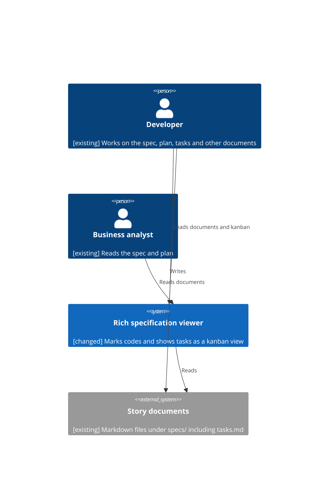

<!--
  STAGE 1 OF THE DEFINITION PIPELINE: WHY are we doing this?

  Gate: REQ-G01 to REQ-G14 (the Requirements quality gate). Run `eil check` to evaluate it.
  Approval: one recorded confirmation from the developer (or a person named in the extension's
  eil-config.yml). The AI drafts and challenges; it cannot approve.

  - Describe the problem and the outcome. Do not prescribe an implementation.
  - Tag any text the AI wrote with until a human has reviewed it. Approval is refused
    while a tag remains (unless a named override is recorded).
  - A section that does not apply is removed and listed under "Not applicable" with a reason.
  - Open questions are not assumptions. Never turn one into the other without a human decision.
-->

# Requirements: Cross-reference codes and tasks kanban view

## Background

<!-- Context that led to the work: business or technical context, the current situation, existing problems, relevant history, and why the issue exists now. -->

The viewer recognises reference codes only for a fixed list of prefixes (`REQ`, `UC`, `OQ`, `ART`, `CH`, `FR`, `NFR`, `SC`, `DEC`, `AIS`, `EVD`, `D-`, `T`). A story can introduce codes of its own, for example `VO-001` in the "Verification Only Where It Is Possible" story, and these are not marked or resolved when they are mentioned elsewhere in the documentation. Task lists (`tasks.md`) are shown as ordinary Markdown, although they are the main view of progress during a build.

## Problem Statement

<!-- Who or what is affected, what is happening, why it is a problem, and what happens if it is left unresolved. -->

A reader of a story's documents meets codes that the viewer ignores because their prefix is not on the fixed list, so they cannot hover or follow them, and new kinds of code need a change to the viewer each time. Separately, a reader who wants to know where a build stands has to read a long checkbox list in `tasks.md` to see what is done and what is outstanding.

## Desired Outcome

<!-- The outcome the organisation wants, as outcomes rather than implementation. One item per line: `**REQ-001**: the system detects duplicate customers on import`. -->

**REQ-001**: A code whose form is introduced in a story's documents is recognised wherever it is referenced in that story, without the viewer being told about the new form.

**REQ-002**: A form of code is considered introduced when a code of that form starts a heading or starts a bullet point in one of the story's documents.

**REQ-003**: A reader can see the progress of a story's tasks as a kanban view built from its `tasks.md`.

**REQ-005**: The existing fixed list of prefixes keeps working. (decided: OQ-001)

**REQ-006**: A code at the start of a table row also introduces a form of code, but only when the first column of that row holds just that one code and the next column holds a description of it, judged by structure alone, and the row is then the code's defining section. A table whose rows only point back to a code defined elsewhere does not introduce a form. (decided: OQ-002)

**REQ-007**: The kanban view is read-only. (decided: OQ-003)

**REQ-008**: The kanban columns are backlog, in progress, blocked and done. (decided: OQ-004)

**REQ-009**: Code discovery is limited to the current story. (decided: OQ-005)

**REQ-010**: When a story has no `tasks.md` or an empty one, the kanban view shows a message that no tasks were found in place of the board. (decided: CH-001)

**REQ-011**: A task is placed in the in progress column by a `[~]` marker on its task line or an `(in progress)` tag in its description, and in the blocked column by a `[!]` marker or a `(blocked)` tag; a task marked done is in the done column and any other task is in the backlog. (decided: CH-002)

**REQ-012**: A page showing a document or the kanban view updates itself when the saved file it shows changes, so that what is on screen matches the file. (decided: CH-010) [ai-draft]

**REQ-004**: The kanban view shows each task as a card with its task ID, story label and description, and lets cards be grouped by phase or user story, as the `tasks.md` of the reference story `003-no-tooling-manual-verification` in `speckit-tdd-integrated` is organised.

## Users and Stakeholders

<!-- One bullet per user, system, team, business stakeholder or external party: `- **Data Analyst**: reviews flagged duplicates`. Every one of them must appear in the system context diagram below. -->

- **Developer**: works on the spec, plan, tasks and all of the other documents of a story.
- **Business analyst**: reads the spec and plan.

## Use Cases

<!-- One item per significant use case, with its actor, goal, trigger and expected outcome: `**UC-001**: Analyst reviews a flagged duplicate (actor: ...; goal: ...; trigger: ...; outcome: ...)`. -->

**UC-001**: Business analyst follows a newly introduced code (actor: Business analyst; goal: see what a code such as VO-001 means; trigger: hovers it in a document that only references it; outcome: the defining section is shown and clicking opens it).

**UC-002**: Developer checks build progress (actor: Developer; goal: see which tasks are outstanding and which are done; trigger: opens the kanban view for a story; outcome: tasks are shown as cards on a board).

## Scope

### In Scope

<!-- What this work will address. -->

- Recognising codes whose form is introduced by a heading, a bullet start or a qualifying table row in the story's documents.
- A kanban view of a story's `tasks.md`.

### Out of Scope

- Changing tasks from the viewer (decided: OQ-003).

## Constraints

<!-- Regulatory, security, architectural, technology, compatibility, budget, time or operational constraints. -->

- The existing behaviour for the current prefixes, including errors for undefined or ambiguous codes, must keep working.
- The viewer's existing constraints (no configuration, nothing to install, nothing outside the start folder) continue to apply.

## Dependencies

<!-- One bullet per system, service, team, data source, infrastructure item or other piece of work this depends on: `- **CRM**: the existing customer store`. Every system must appear in the system context diagram below. -->

- **Story documents**: the Markdown files under `specs/` that the viewer reads, including `tasks.md`.

## Risks

<!-- Known risks to achieving the desired outcome. -->

- Ordinary words or numbers in capitals at the start of a heading or bullet could be taken as a new form of code and produce false errors for undefined codes.
- Task lists differ between stories, so a kanban built around one story's layout may not suit another.

## Assumptions

<!-- Assumptions being made now. Validate them where practical. These are not open questions. -->

- A "code" has the shape of letters, a hyphen and digits, as in `VO-001`.

## Open Questions

<!-- One item per question that could materially affect the solution: `**OQ-001**: Keep customer history? (status: open) (material: yes)`. A material question must be resolved (`status: resolved`), or accepted by a named person (`status: accepted` with `(accepted-by: NAME)`), before approval. -->

**OQ-001**: Must the existing fixed list of prefixes keep working when no definition of that form exists in the story, or is recognition to depend only on discovered definitions? (status: resolved) (material: yes) (answer: yes)

**OQ-002**: Does a code count as introduced only when it is the first thing in a heading or bullet, or also when it is the first cell of a table row? (status: resolved) (material: yes) (answer: yes look for patterns like [A-Z][A-Z]-[0-9][0-9][0-9] or [A-Z][A-Z][A-Z]-[0-9][0-9][0-9] (use better regex); refined: only a table whose first column holds just one code and whose next column is a description counts, judged by structure alone, with the row as the defining section)

**OQ-003**: Is the kanban view read-only? (status: resolved) (material: yes) (answer: yes)

**OQ-004**: What are the kanban columns? `tasks.md` in the reference story marks tasks only as open or done, so columns such as To do and Done, columns per phase, or both need a decision. (status: resolved) (material: yes) (answer: backlog, in progress, blocked and done)

**OQ-005**: Is the discovery of code forms limited to the viewed story, or shared across all stories? (status: resolved) (material: yes) (answer: yes limited to the current story)

## Success Criteria

<!-- Observable outcomes that show the problem is solved. -->

- `VO-001` referenced in a document is marked and resolves to its definition in the reference story without any viewer change.
- The reference story's `tasks.md` is shown as a kanban view in which every task appears exactly once.
- Each task appears in exactly one of backlog, in progress, blocked or done, and a table of pure back-references defines no code.

## System Context

<!--
  The system as one box, with the people and systems around it (C4 Level 1). Every person under
  Users and Stakeholders and every system under Dependencies must appear here, and every element
  says whether it is [existing], [new] or [changed]. No screens and no internals belong here.

  **ART-001**: System context (traces: REQ-001)

  ```mermaid
  C4Context
    Person(analyst, "Data Analyst", "[existing] Reviews flagged duplicates")
    System(platform, "Customer Platform", "[changed] Detects duplicates on import")
    System_Ext(crm, "CRM", "[existing] Customer store")
    Rel(analyst, platform, "Reviews duplicates")
    Rel(platform, crm, "Reads customers")
  ```
-->

**ART-001**: System context (traces: REQ-001)



## Not applicable

<!-- Sections removed from this document, each with its reason: `- Constraints: none for this spike`. -->

## Challenges

<!-- Recorded by `eil challenge`. -->

```eil:challenge
{
  "id": "CH-001",
  "stage": "requirements",
  "raised_by": "ai",
  "raised_at": "2026-10-16T21:31:50Z",
  "target": "REQ-003",
  "text": "No behaviour is defined for a story with no tasks.md or an empty one; state what the reader sees.",
  "status": "closed",
  "severity": "low",
  "responder": "Lee Sinclair",
  "response": "accepted",
  "at": "2026-10-16T22:11:15Z",
  "reason": "accept both"
}
```

```eil:challenge
{
  "id": "CH-002",
  "stage": "requirements",
  "raised_by": "ai",
  "raised_at": "2026-10-16T22:10:22Z",
  "target": "REQ-008",
  "text": "tasks.md only marks tasks open or done, so nothing in it says which tasks are in progress or blocked; state how a task is placed in the in progress and blocked columns.",
  "status": "closed",
  "severity": "high",
  "responder": "Lee Sinclair",
  "response": "accepted",
  "at": "2026-10-16T22:11:16Z",
  "reason": "accept both"
}
```

```eil:challenge
{
  "id": "CH-010",
  "stage": "requirements",
  "raised_by": "ai",
  "raised_at": "2026-10-17T00:19:31Z",
  "target": "REQ-003",
  "text": "No requirement says that a page the viewer is showing updates itself. Add a requirement that every document page and the kanban view refresh automatically when the file they show changes (its timestamp changes), so what is on screen matches the saved file.",
  "status": "closed",
  "severity": "medium",
  "responder": "Lee Sinclair",
  "response": "accepted",
  "at": "2026-10-17T01:54:33Z",
  "reason": "appprove"
}
```

## Overrides

<!-- Recorded by `eil override`, each naming who, what and why. -->

## Change Log

<!-- eil:begin changelog -->
<!-- eil:end changelog -->

## Record

<!-- eil:begin provenance -->
```json
{
  "version": 1,
  "blocks": {
    "REQ-001": {
      "hash": "sha256:61e559eef48ae3d2bcafefa82d6db74a8356d04d3b827a3821dddbb4bf197af2",
      "class": "inferred",
      "reviewed": {
        "by": "Lee Sinclair",
        "at": "2026-10-16T22:10:28Z",
        "list": "RVW-001",
        "reply": "yes (reviewed item by item in conversation; accepted every block, with the changes made to REQ-002/REQ-006, REQ-004, Users, Scope and Success Criteria as discussed)"
      }
    },
    "REQ-002": {
      "hash": "sha256:9be8cbf31c66cda1de24eb6018e9793bc3124a9883583b70cee59847b13ca3a5",
      "class": "inferred",
      "reviewed": {
        "by": "Lee Sinclair",
        "at": "2026-10-16T22:10:28Z",
        "list": "RVW-001",
        "reply": "yes (reviewed item by item in conversation; accepted every block, with the changes made to REQ-002/REQ-006, REQ-004, Users, Scope and Success Criteria as discussed)"
      }
    },
    "REQ-003": {
      "hash": "sha256:3755f308fed60ce65095a51a1ac6c761e9b9fe1a247dd166b82dfb773272081e",
      "class": "inferred",
      "reviewed": {
        "by": "Lee Sinclair",
        "at": "2026-10-16T22:10:28Z",
        "list": "RVW-001",
        "reply": "yes (reviewed item by item in conversation; accepted every block, with the changes made to REQ-002/REQ-006, REQ-004, Users, Scope and Success Criteria as discussed)"
      }
    },
    "REQ-005": {
      "hash": "sha256:b7dfc78315bdbaf546f86f722dce88987080968d3808e250013a20df55372105",
      "class": "decided",
      "basis": "decided: OQ-001"
    },
    "REQ-006": {
      "hash": "sha256:859e9801daa175a7b2b81fda318548d186d0568e0b2a1241b2ae4cdfae93648f",
      "class": "decided",
      "basis": "decided: OQ-002"
    },
    "REQ-007": {
      "hash": "sha256:f510a28f216be7dedb6d892aeaf8f92e1f99cbacc3300e721fbbfd7d5690abe6",
      "class": "decided",
      "basis": "decided: OQ-003"
    },
    "REQ-008": {
      "hash": "sha256:db8e8f7793ed484c0fa0960c264ff2a063be41609db925ee0e2e9e49d6cd4f45",
      "class": "decided",
      "basis": "decided: OQ-004"
    },
    "REQ-009": {
      "hash": "sha256:2acb805067e30d87ac45c5f1d0d4a41128a107a4cef12c892e0cf612bda9d42c",
      "class": "decided",
      "basis": "decided: OQ-005"
    },
    "REQ-004": {
      "hash": "sha256:11ced25bc5b5a0f3bef0f22de7471d625296fc8ce169ef0d70a30c9f5ffdf44b",
      "class": "inferred",
      "adds": "card contents and grouping chosen by the AI and confirmed by the person",
      "reviewed": {
        "by": "Lee Sinclair",
        "at": "2026-10-16T22:10:28Z",
        "list": "RVW-001",
        "reply": "yes (reviewed item by item in conversation; accepted every block, with the changes made to REQ-002/REQ-006, REQ-004, Users, Scope and Success Criteria as discussed)"
      }
    },
    "UC-001": {
      "hash": "sha256:3e691638c6e12461844d68e2f386ebdc36afc48a479fee7bbc5ada6fafc54fb8",
      "class": "inferred",
      "adds": "actor changed to Business analyst",
      "reviewed": {
        "by": "Lee Sinclair",
        "at": "2026-10-16T22:10:28Z",
        "list": "RVW-001",
        "reply": "yes (reviewed item by item in conversation; accepted every block, with the changes made to REQ-002/REQ-006, REQ-004, Users, Scope and Success Criteria as discussed)"
      }
    },
    "UC-002": {
      "hash": "sha256:d058ae80de91413ede200a910ed88df18487cbe335ac361823fff73bd99322be",
      "class": "inferred",
      "adds": "actor changed to Developer",
      "reviewed": {
        "by": "Lee Sinclair",
        "at": "2026-10-16T22:10:28Z",
        "list": "RVW-001",
        "reply": "yes (reviewed item by item in conversation; accepted every block, with the changes made to REQ-002/REQ-006, REQ-004, Users, Scope and Success Criteria as discussed)"
      }
    },
    "OQ-001": {
      "hash": "sha256:3be55ff7a7b39c0cdd205a6599d5938c9412c739a6008c6293eab34626198911",
      "class": "inferred",
      "reviewed": {
        "by": "Lee Sinclair",
        "at": "2026-10-16T22:10:28Z",
        "list": "RVW-001",
        "reply": "yes (reviewed item by item in conversation; accepted every block, with the changes made to REQ-002/REQ-006, REQ-004, Users, Scope and Success Criteria as discussed)"
      }
    },
    "OQ-002": {
      "hash": "sha256:8be8053767bb14e94b1d34f5cad4d3ee2a092ba5a587030ad59e11419ba019db",
      "class": "inferred",
      "reviewed": {
        "by": "Lee Sinclair",
        "at": "2026-10-16T22:10:28Z",
        "list": "RVW-001",
        "reply": "yes (reviewed item by item in conversation; accepted every block, with the changes made to REQ-002/REQ-006, REQ-004, Users, Scope and Success Criteria as discussed)"
      }
    },
    "OQ-003": {
      "hash": "sha256:18e67844f1349359a5b0c21310889c75da60de506cc207653a284cc5fd34e9c0",
      "class": "inferred",
      "reviewed": {
        "by": "Lee Sinclair",
        "at": "2026-10-16T22:10:28Z",
        "list": "RVW-001",
        "reply": "yes (reviewed item by item in conversation; accepted every block, with the changes made to REQ-002/REQ-006, REQ-004, Users, Scope and Success Criteria as discussed)"
      }
    },
    "OQ-004": {
      "hash": "sha256:e41859083e8165fb6b744889177c4f36816f2f57886ec58506040629051bbe22",
      "class": "inferred",
      "reviewed": {
        "by": "Lee Sinclair",
        "at": "2026-10-16T22:10:28Z",
        "list": "RVW-001",
        "reply": "yes (reviewed item by item in conversation; accepted every block, with the changes made to REQ-002/REQ-006, REQ-004, Users, Scope and Success Criteria as discussed)"
      }
    },
    "OQ-005": {
      "hash": "sha256:49bd7ebcbc208e04786f899eeadabe49c3f673cb056edb4c5d3e8be6f93cefcc",
      "class": "inferred",
      "reviewed": {
        "by": "Lee Sinclair",
        "at": "2026-10-16T22:10:28Z",
        "list": "RVW-001",
        "reply": "yes (reviewed item by item in conversation; accepted every block, with the changes made to REQ-002/REQ-006, REQ-004, Users, Scope and Success Criteria as discussed)"
      }
    },
    "ART-001": {
      "hash": "sha256:86c8f49df2bedd958e24bdebfd6c865e8b7acb3fa4623c080e1f4cf2df07186f",
      "class": "inferred",
      "reviewed": {
        "by": "Lee Sinclair",
        "at": "2026-10-16T22:10:28Z",
        "list": "RVW-001",
        "reply": "yes (reviewed item by item in conversation; accepted every block, with the changes made to REQ-002/REQ-006, REQ-004, Users, Scope and Success Criteria as discussed)"
      }
    },
    "Background#307b2f71133d": {
      "hash": "sha256:307b2f71133d5affb6ad6bb243d762c51163ef277320fd81a2fd4e77117a4e43",
      "reviewed": {
        "by": "Lee Sinclair",
        "at": "2026-10-16T22:10:28Z",
        "list": "RVW-001",
        "reply": "yes (reviewed item by item in conversation; accepted every block, with the changes made to REQ-002/REQ-006, REQ-004, Users, Scope and Success Criteria as discussed)"
      },
      "class": "inferred"
    },
    "Problem Statement#989823066555": {
      "hash": "sha256:989823066555ba5207861eb90bdeeac840c461c95588adfa1dbd02128f519de4",
      "reviewed": {
        "by": "Lee Sinclair",
        "at": "2026-10-16T22:10:28Z",
        "list": "RVW-001",
        "reply": "yes (reviewed item by item in conversation; accepted every block, with the changes made to REQ-002/REQ-006, REQ-004, Users, Scope and Success Criteria as discussed)"
      },
      "class": "inferred"
    },
    "Users and Stakeholders#d8e3e16b932c": {
      "hash": "sha256:d8e3e16b932c96b869f66ef5f711ed6a1d4ed02018e52770410c15d5b369de0c",
      "reviewed": {
        "by": "Lee Sinclair",
        "at": "2026-10-16T22:10:28Z",
        "list": "RVW-001",
        "reply": "yes (reviewed item by item in conversation; accepted every block, with the changes made to REQ-002/REQ-006, REQ-004, Users, Scope and Success Criteria as discussed)"
      },
      "class": "inferred"
    },
    "Scope#6db9acce43f0": {
      "hash": "sha256:6db9acce43f0269c8754ae11fcf66838f3bcd343d1d5446d76a363fbd65c9621",
      "reviewed": {
        "by": "Lee Sinclair",
        "at": "2026-10-16T22:10:28Z",
        "list": "RVW-001",
        "reply": "yes (reviewed item by item in conversation; accepted every block, with the changes made to REQ-002/REQ-006, REQ-004, Users, Scope and Success Criteria as discussed)"
      },
      "class": "inferred"
    },
    "Scope#13922699e921": {
      "hash": "sha256:13922699e92169ef5c6d941e0376c27fc096db31ddd814386a9b00f437784a89",
      "reviewed": {
        "by": "Lee Sinclair",
        "at": "2026-10-16T22:10:28Z",
        "list": "RVW-001",
        "reply": "yes (reviewed item by item in conversation; accepted every block, with the changes made to REQ-002/REQ-006, REQ-004, Users, Scope and Success Criteria as discussed)"
      },
      "class": "inferred"
    },
    "Constraints#30ba80a90c9a": {
      "hash": "sha256:30ba80a90c9a1be17b0fe91133c3bd6786110bbb6a59e415ce3319d062de5296",
      "reviewed": {
        "by": "Lee Sinclair",
        "at": "2026-10-16T22:10:28Z",
        "list": "RVW-001",
        "reply": "yes (reviewed item by item in conversation; accepted every block, with the changes made to REQ-002/REQ-006, REQ-004, Users, Scope and Success Criteria as discussed)"
      },
      "class": "inferred"
    },
    "Dependencies#f4d7ffb86359": {
      "hash": "sha256:f4d7ffb8635907a768b6e9f6ad1b94d08930aa9c4f950a09eb90b8ba84e0a92a",
      "reviewed": {
        "by": "Lee Sinclair",
        "at": "2026-10-16T22:10:28Z",
        "list": "RVW-001",
        "reply": "yes (reviewed item by item in conversation; accepted every block, with the changes made to REQ-002/REQ-006, REQ-004, Users, Scope and Success Criteria as discussed)"
      },
      "class": "inferred"
    },
    "Risks#aace3ee4c474": {
      "hash": "sha256:aace3ee4c47476af825a596cf175bf9b622141945ecfd4f30db18486a6182d85",
      "reviewed": {
        "by": "Lee Sinclair",
        "at": "2026-10-16T22:10:28Z",
        "list": "RVW-001",
        "reply": "yes (reviewed item by item in conversation; accepted every block, with the changes made to REQ-002/REQ-006, REQ-004, Users, Scope and Success Criteria as discussed)"
      },
      "class": "inferred"
    },
    "Assumptions#7e219c2b0e1f": {
      "hash": "sha256:7e219c2b0e1f86ed5af475e5c5bf807620b35d5b9ac618cfc6c7fd19bdc0adb3",
      "reviewed": {
        "by": "Lee Sinclair",
        "at": "2026-10-16T22:10:28Z",
        "list": "RVW-001",
        "reply": "yes (reviewed item by item in conversation; accepted every block, with the changes made to REQ-002/REQ-006, REQ-004, Users, Scope and Success Criteria as discussed)"
      },
      "class": "inferred"
    },
    "Success Criteria#1bf6ddca5339": {
      "hash": "sha256:1bf6ddca533945458fa8856b29d568065b9e511e990159db6841f83728d9ef22",
      "reviewed": {
        "by": "Lee Sinclair",
        "at": "2026-10-16T22:10:28Z",
        "list": "RVW-001",
        "reply": "yes (reviewed item by item in conversation; accepted every block, with the changes made to REQ-002/REQ-006, REQ-004, Users, Scope and Success Criteria as discussed)"
      },
      "class": "inferred"
    },
    "REQ-010": {
      "hash": "sha256:6c90a9a0ceeebd560ba40c37f900ba9247153a25e17cbab86fc3a1b45e0029c9",
      "class": "decided",
      "basis": "decided: CH-001"
    },
    "REQ-011": {
      "hash": "sha256:7c69a45314c4e67bc3c8e0c9b0325ba25d0d554672948654cf5d1f0effef4ea1",
      "class": "decided",
      "basis": "decided: CH-002"
    }
  },
  "acceptances": [
    {
      "id": "RVW-001",
      "stage": "requirements",
      "kind": "inferred",
      "digest": "sha256:97965a81d41168de77b526a1820ab3285ec16fc5a7226eeaf409caa320989946",
      "by": "Lee Sinclair",
      "at": "2026-10-16T22:10:28Z",
      "reply": "yes (reviewed item by item in conversation; accepted every block, with the changes made to REQ-002/REQ-006, REQ-004, Users, Scope and Success Criteria as discussed)",
      "accepted": [
        "Background#307b2f71133d",
        "Problem Statement#989823066555",
        "REQ-001",
        "REQ-002",
        "REQ-003",
        "REQ-004",
        "Users and Stakeholders#d8e3e16b932c",
        "UC-001",
        "UC-002",
        "Scope#6db9acce43f0",
        "Scope#13922699e921",
        "Constraints#30ba80a90c9a",
        "Dependencies#f4d7ffb86359",
        "Risks#aace3ee4c474",
        "Assumptions#7e219c2b0e1f",
        "OQ-001",
        "OQ-002",
        "OQ-003",
        "OQ-004",
        "OQ-005",
        "Success Criteria#1bf6ddca5339",
        "ART-001"
      ],
      "except": [],
      "questioned": [],
      "reopened": [],
      "reason": null,
      "hashes": {
        "Background#307b2f71133d": "sha256:307b2f71133d5affb6ad6bb243d762c51163ef277320fd81a2fd4e77117a4e43",
        "Problem Statement#989823066555": "sha256:989823066555ba5207861eb90bdeeac840c461c95588adfa1dbd02128f519de4",
        "REQ-001": "sha256:61e559eef48ae3d2bcafefa82d6db74a8356d04d3b827a3821dddbb4bf197af2",
        "REQ-002": "sha256:9be8cbf31c66cda1de24eb6018e9793bc3124a9883583b70cee59847b13ca3a5",
        "REQ-003": "sha256:3755f308fed60ce65095a51a1ac6c761e9b9fe1a247dd166b82dfb773272081e",
        "REQ-004": "sha256:11ced25bc5b5a0f3bef0f22de7471d625296fc8ce169ef0d70a30c9f5ffdf44b",
        "Users and Stakeholders#d8e3e16b932c": "sha256:d8e3e16b932c96b869f66ef5f711ed6a1d4ed02018e52770410c15d5b369de0c",
        "UC-001": "sha256:3e691638c6e12461844d68e2f386ebdc36afc48a479fee7bbc5ada6fafc54fb8",
        "UC-002": "sha256:d058ae80de91413ede200a910ed88df18487cbe335ac361823fff73bd99322be",
        "Scope#6db9acce43f0": "sha256:6db9acce43f0269c8754ae11fcf66838f3bcd343d1d5446d76a363fbd65c9621",
        "Scope#13922699e921": "sha256:13922699e92169ef5c6d941e0376c27fc096db31ddd814386a9b00f437784a89",
        "Constraints#30ba80a90c9a": "sha256:30ba80a90c9a1be17b0fe91133c3bd6786110bbb6a59e415ce3319d062de5296",
        "Dependencies#f4d7ffb86359": "sha256:f4d7ffb8635907a768b6e9f6ad1b94d08930aa9c4f950a09eb90b8ba84e0a92a",
        "Risks#aace3ee4c474": "sha256:aace3ee4c47476af825a596cf175bf9b622141945ecfd4f30db18486a6182d85",
        "Assumptions#7e219c2b0e1f": "sha256:7e219c2b0e1f86ed5af475e5c5bf807620b35d5b9ac618cfc6c7fd19bdc0adb3",
        "OQ-001": "sha256:3be55ff7a7b39c0cdd205a6599d5938c9412c739a6008c6293eab34626198911",
        "OQ-002": "sha256:8be8053767bb14e94b1d34f5cad4d3ee2a092ba5a587030ad59e11419ba019db",
        "OQ-003": "sha256:18e67844f1349359a5b0c21310889c75da60de506cc207653a284cc5fd34e9c0",
        "OQ-004": "sha256:e41859083e8165fb6b744889177c4f36816f2f57886ec58506040629051bbe22",
        "OQ-005": "sha256:49bd7ebcbc208e04786f899eeadabe49c3f673cb056edb4c5d3e8be6f93cefcc",
        "Success Criteria#1bf6ddca5339": "sha256:1bf6ddca533945458fa8856b29d568065b9e511e990159db6841f83728d9ef22",
        "ART-001": "sha256:86c8f49df2bedd958e24bdebfd6c865e8b7acb3fa4623c080e1f4cf2df07186f"
      }
    }
  ]
}
```
<!-- eil:end provenance -->

## Quality Assessment

<!-- eil:begin assessment -->
```json
{
  "stage": "requirements",
  "evaluated_at": "2026-10-16T22:15:37Z",
  "fingerprint": "sha256:980512a791e2b49ff1c43d95830e614deb627208669929c2ecb3683b59772514",
  "criteria": [
    {
      "id": "REQ-G01",
      "kind": "judgment",
      "status": "met",
      "reason": "AI assessment: Problem and affected readers are stated.",
      "basis": "sha256:c20abd0af6fd29c3a79ce402e9d5345feeb5f99a89bca757a61514a842c66b17"
    },
    {
      "id": "REQ-G02",
      "kind": "structural",
      "status": "met",
      "reason": ""
    },
    {
      "id": "REQ-G03",
      "kind": "structural",
      "status": "met",
      "reason": ""
    },
    {
      "id": "REQ-G04",
      "kind": "structural",
      "status": "met",
      "reason": ""
    },
    {
      "id": "REQ-G05",
      "kind": "structural",
      "status": "met",
      "reason": ""
    },
    {
      "id": "REQ-G06",
      "kind": "structural",
      "status": "met",
      "reason": ""
    },
    {
      "id": "REQ-G07",
      "kind": "structural",
      "status": "met",
      "reason": ""
    },
    {
      "id": "REQ-G08",
      "kind": "structural",
      "status": "met",
      "reason": ""
    },
    {
      "id": "REQ-G09",
      "kind": "structural",
      "status": "met",
      "reason": ""
    },
    {
      "id": "REQ-G10",
      "kind": "traceability",
      "status": "met",
      "reason": ""
    },
    {
      "id": "REQ-G11",
      "kind": "judgment",
      "status": "met",
      "reason": "AI assessment: Outcomes describe behaviour, not implementation.",
      "basis": "sha256:c25c7e1928524f362fd25d5466c7a4d3f131987c784eda7689ef409a6ee69afe"
    },
    {
      "id": "REQ-G12",
      "kind": "judgment",
      "status": "met",
      "reason": "AI assessment: Success criteria are observable.",
      "basis": "sha256:980512a791e2b49ff1c43d95830e614deb627208669929c2ecb3683b59772514"
    },
    {
      "id": "REQ-G13",
      "kind": "judgment",
      "status": "met",
      "reason": "AI assessment: Open questions are kept separate from assumptions.",
      "basis": "sha256:980512a791e2b49ff1c43d95830e614deb627208669929c2ecb3683b59772514"
    },
    {
      "id": "REQ-G14",
      "kind": "structural",
      "status": "met",
      "reason": ""
    }
  ],
  "assessment": {
    "ambiguity": [
      "REQ-004 'comparable to' the reference story is loose; columns undecided (OQ-004)"
    ],
    "missing": [
      "Behaviour for stories with no tasks.md"
    ],
    "contradictions": [],
    "unsupported_assumptions": [
      "Code shape letters-hyphen-digits"
    ],
    "untestable": []
  },
  "findings": []
}
```
<!-- eil:end assessment -->

## Approval

<!-- eil:begin approval -->
```json
{
  "stage": "requirements",
  "by": "Lee Sinclair",
  "at": "2026-10-17T01:55:46Z",
  "fingerprint": "sha256:5dc8e9debe4a7a06f5aff70aff530c6e314e2738d41b3b434f7a1c61e88339fb",
  "amended": true,
  "amends": [
    "CH-010"
  ],
  "reached": "carried-forward",
  "rests_on": [
    "CH-010"
  ],
  "sign_off": "yes amend both",
  "upstream": {},
  "items": {
    "REQ-001": "sha256:61e559eef48ae3d2bcafefa82d6db74a8356d04d3b827a3821dddbb4bf197af2",
    "REQ-002": "sha256:9be8cbf31c66cda1de24eb6018e9793bc3124a9883583b70cee59847b13ca3a5",
    "REQ-003": "sha256:3755f308fed60ce65095a51a1ac6c761e9b9fe1a247dd166b82dfb773272081e",
    "REQ-005": "sha256:b7dfc78315bdbaf546f86f722dce88987080968d3808e250013a20df55372105",
    "REQ-006": "sha256:859e9801daa175a7b2b81fda318548d186d0568e0b2a1241b2ae4cdfae93648f",
    "REQ-007": "sha256:f510a28f216be7dedb6d892aeaf8f92e1f99cbacc3300e721fbbfd7d5690abe6",
    "REQ-008": "sha256:db8e8f7793ed484c0fa0960c264ff2a063be41609db925ee0e2e9e49d6cd4f45",
    "REQ-009": "sha256:2acb805067e30d87ac45c5f1d0d4a41128a107a4cef12c892e0cf612bda9d42c",
    "REQ-010": "sha256:6c90a9a0ceeebd560ba40c37f900ba9247153a25e17cbab86fc3a1b45e0029c9",
    "REQ-011": "sha256:7c69a45314c4e67bc3c8e0c9b0325ba25d0d554672948654cf5d1f0effef4ea1",
    "REQ-012": "sha256:fcb33e719611733ed088a72bb7e1fccbcfd5843c6ed9a4246d3895a161a7e414",
    "REQ-004": "sha256:11ced25bc5b5a0f3bef0f22de7471d625296fc8ce169ef0d70a30c9f5ffdf44b",
    "UC-001": "sha256:3e691638c6e12461844d68e2f386ebdc36afc48a479fee7bbc5ada6fafc54fb8",
    "UC-002": "sha256:d058ae80de91413ede200a910ed88df18487cbe335ac361823fff73bd99322be",
    "OQ-001": "sha256:3be55ff7a7b39c0cdd205a6599d5938c9412c739a6008c6293eab34626198911",
    "OQ-002": "sha256:8be8053767bb14e94b1d34f5cad4d3ee2a092ba5a587030ad59e11419ba019db",
    "OQ-003": "sha256:18e67844f1349359a5b0c21310889c75da60de506cc207653a284cc5fd34e9c0",
    "OQ-004": "sha256:e41859083e8165fb6b744889177c4f36816f2f57886ec58506040629051bbe22",
    "OQ-005": "sha256:49bd7ebcbc208e04786f899eeadabe49c3f673cb056edb4c5d3e8be6f93cefcc",
    "ART-001": "sha256:86c8f49df2bedd958e24bdebfd6c865e8b7acb3fa4623c080e1f4cf2df07186f"
  },
  "section_fingerprints": {
    "Background": "sha256:08cc1d4d0d6b1eee17f728d0d7b3bf07843ffaf4905f4037047d3d77ee156b3d",
    "Problem Statement": "sha256:742361e3425ced8a11f47e903c92c412a1fc31c1576c665d317a4cf6da3a35d2",
    "Desired Outcome": "sha256:d9dd808a006024117bf272d634a4e788a38ec182b0a9ef0a922e69ec2ec255d5",
    "Users and Stakeholders": "sha256:8639bb74a8e0a48bca0012e18395f8e19c400022bdce8cb071bab0a8a5628f9c",
    "Use Cases": "sha256:abcbada836b21d247d65af761737aad1af1b0dcf8987103ae95bf9cc7ffd9088",
    "Scope": "sha256:7c0f05dc8b7e63d345ae29ead7f23afbc42412dc51cc4262258d46cd1ce23c39",
    "Constraints": "sha256:478aedac21ca11fec805894a753be5ea3a1c3d4f831fc806c5e78f02c5a7f84c",
    "Dependencies": "sha256:12d9f5b8ca84d934f39783a738126391bf4025bf5b824885859064cb7b8a1f13",
    "Risks": "sha256:f7b4211a730dcb9ffc0f4af5aa3be5f0f7c28c9ea9dfa09e51d026918b663429",
    "Assumptions": "sha256:ccae66bf190a9172da70458c52fa77630106d446355afe7cde1498488224bf80",
    "Open Questions": "sha256:dbf7ea0526ccfe334b13a399b33cff2851efeea5ea004dd48d523aebe9af93f6",
    "Success Criteria": "sha256:17b4ba04824bcc48d444493a61ad60083db225b2a49be2eb8a3262f2055904ef",
    "System Context": "sha256:ecd6754840062ee55e40a41c9888bd2ea1ce768ce36e76f3e3b5c9b183ae39d6",
    "Not applicable": "sha256:84020274243b31aa521d57b121f0aec1b40089683a488aff826d27ffc80c957f"
  },
  "upstream_items": {},
  "overrides_used": []
}
```
<!-- eil:end approval -->
