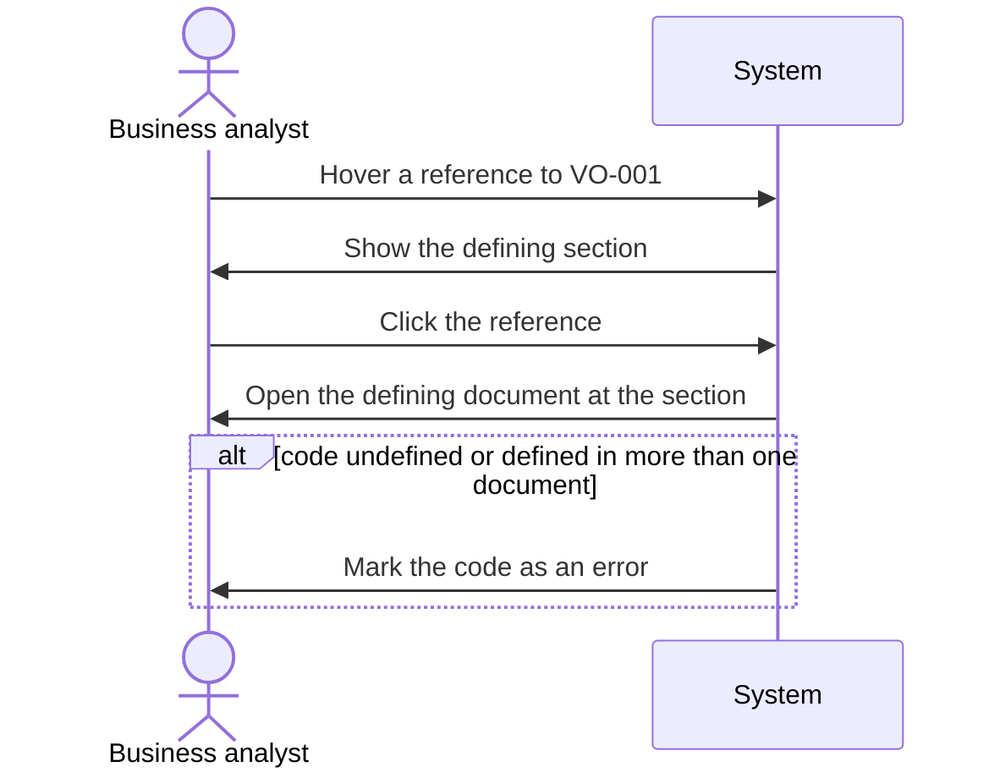
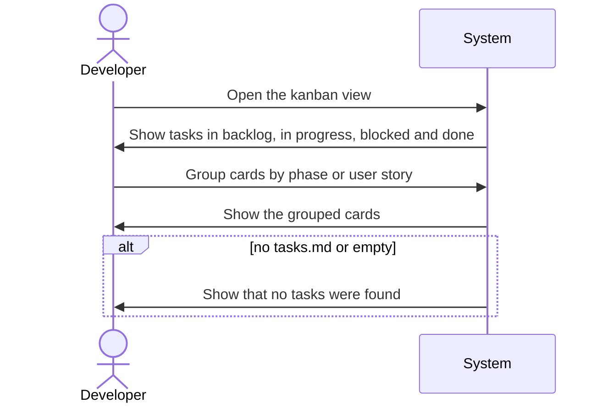

<!--
  STAGE 2 OF THE DEFINITION PIPELINE: WHAT must the system do?

  Gate: FUN-G01 to FUN-G16 (the Functional quality gate). Run `eil check --stage functional`.
  Approval: one recorded confirmation from the developer (or a person named in eil-config.yml),
  after the comprehension check has been taken on this version (`/speckit-eil-comprehend`).

  - Describe behaviour, not implementation. "Store it in PostgreSQL" belongs in the Technical stage.
  - Every functional requirement traces to an approved requirement or use case.
  - Tag any text the AI wrote with [ai-draft] until a human has reviewed it.
  - A section that does not apply is removed and listed under "Not applicable" with a reason.
-->

# Functional Specification: Cross-reference codes and tasks kanban view

## Requirements Traceability

<!-- Which requirements each functional requirement satisfies, at a glance. The gate reads the `(traces: ...)` clauses on the items themselves. -->

| Requirement | Functional requirements |
|---|---|
| REQ-001 | FR-001, FR-003 |
| REQ-002 | FR-001 |
| REQ-003 | FR-006, FR-011 |
| REQ-004 | FR-007, FR-011 |
| REQ-005 | FR-004 |
| REQ-006 | FR-002 |
| REQ-007 | FR-009 |
| REQ-008 | FR-008 |
| REQ-009 | FR-005 |
| REQ-010 | FR-010 |
| REQ-011 | FR-008 |
| REQ-012 | FR-012 |

## Actors

<!-- Everyone and everything that interacts with the capability: `- **Data Analyst**: reviews flagged duplicates`. Users, administrators, internal or external systems, scheduled processes, AI agents. Sequence diagrams below may name only these and the System. -->

- **Developer**: works on the spec, plan, tasks and all of the other documents of a story.
- **Business analyst**: reads the spec and plan.

## Functional Requirements

<!-- One item per behaviour, written "The system shall ...", each tracing to the requirements or use cases it satisfies: `**FR-001**: The system shall flag duplicate customers on import. (traces: REQ-001)`. -->

**FR-001**: The system shall treat the prefix of a code (two or more capital letters, a hyphen and one or more digits, such as `VO-001`) as a form of code when a code with that prefix starts a heading or starts a bullet point in a document of the story. (traces: REQ-001, REQ-002) (decided: CH-003)

**FR-002**: The system shall also treat a code as introducing a form of code when it is the only content of the first column of a table row and the next column of that row holds a description, judged by structure alone, and shall take that row as the code's defining section; a table whose rows only point back to a code defined elsewhere shall introduce no form. (traces: REQ-006)

**FR-003**: The system shall mark every code of a discovered form wherever it is referenced in a document of the story, with the same hover, click and error behaviour as the codes already recognised. (traces: REQ-001, UC-001)

**FR-004**: The system shall keep recognising the existing fixed list of prefixes, including the errors for undefined and ambiguous codes. (traces: REQ-005)

**FR-005**: The system shall discover forms of code only from the documents of the story being viewed, and shall not carry a form discovered in one story into another. (traces: REQ-009)

**FR-006**: The system shall show, for a story, a kanban view of the tasks in its `tasks.md`. (traces: REQ-003, UC-002)

**FR-007**: The system shall show each task in the kanban view as a card with its task ID, story label and description, and shall let the developer group cards by phase or by user story. (traces: REQ-004)

**FR-011**: The system shall offer the kanban view of a story as a page reached from a link on that story's pages, and shall group its cards by phase unless the developer chooses to group them by user story. (traces: REQ-003, REQ-004) (decided: CH-004)

**FR-008**: The system shall place each task in one of four columns: in progress when its task line carries a `[~]` marker or its description an `(in progress)` tag, blocked when it carries a `[!]` marker or a `(blocked)` tag, done when it is marked done, and backlog otherwise. (traces: REQ-008, REQ-011)

**FR-009**: The system shall not change `tasks.md` or any other document from the kanban view. (traces: REQ-007)

**FR-010**: When a story has no `tasks.md` or an empty one, the system shall show a message that no tasks were found in place of the board. (traces: REQ-010)

**FR-012**: The system shall check the file shown by an open document page or kanban view about every 10 seconds, and shall refresh the page with the new content when the file's modified time has changed, keeping the reader's position in a document and the chosen grouping of the kanban view; when the file can no longer be read, the page shall keep showing its last content and not refresh. (traces: REQ-012) (decided: CH-012) (decided: RVW-009)

## Use Cases and Scenarios

<!-- For each use case from the Requirements (name it by its id, for example UC-001): preconditions, trigger, main flow, alternative flows, exception flows and expected outcome. -->

### UC-001: Business analyst follows a newly introduced code

- **Preconditions**: a document of the story introduces a code such as `VO-001` in a heading, a bullet or a qualifying table row, and another document of the story references it.
- **Trigger**: the Business analyst hovers the reference in the other document.
- **Main flow**: the System shows the defining section in a tooltip; the Business analyst clicks it and the System opens the defining document at the defining section.
- **Alternative flow**: the code is defined in the viewed document itself; the System scrolls to it.
- **Exception flow**: the code is not defined, or defined in more than one document of the story; the System marks it as an error.
- **Expected outcome**: the Business analyst reads the definition without searching.

### UC-002: Developer checks build progress

- **Preconditions**: the Developer has opened a story. (decided: CH-005)
- **Trigger**: the Developer opens the kanban view of the story.
- **Main flow**: the System shows the tasks as cards in the backlog, in progress, blocked and done columns.
- **Alternative flow**: the Developer groups the cards by phase or user story.
- **Exception flow**: the story has no `tasks.md` or an empty one; the System shows a message that no tasks were found.
- **Expected outcome**: the Developer sees which tasks are outstanding and which are done.

## Business Rules

<!-- Validation, eligibility, calculation, state-transition, ordering, uniqueness and retention rules, stated explicitly rather than implied by examples. -->

- A prefix is two or more capital letters followed by a hyphen and one or more digits; a code starting a heading or a bullet point introduces its form wherever it appears at the very start. (traces: REQ-002)
- A code in a table row introduces a form only under the table rule of FR-002. (traces: REQ-006)
- Discovered forms are per story. (traces: REQ-009)
- A task that carries both an in progress and a blocked marker or tag is placed in the blocked column. (decided: OQ-006)

## Inputs

<!-- Required and optional inputs, formats, valid ranges, validation and sources. -->

- The Markdown documents of the story being viewed, and its `tasks.md`, as written by the Developer. Task lines use the existing form `- [ ] T001 ...`, with `[X]` for done and `[~]` or `[!]` as markers.

## Outputs

<!-- Outputs, formats, required fields, expected states and consumers. -->

- The viewed page with every code of a discovered form marked.
- The kanban view: four columns of cards, or a message that no tasks were found.

## State and Workflow

<!-- States, transitions, triggers, permitted transitions and terminal states. -->

- A task has one of four states, derived from its line: backlog, in progress, blocked, done. The system derives it on each request and never changes it.

## Validation

<!-- What is valid and invalid input. -->

- A task line is read when it is a checklist item with a task ID. A line that is not a checklist item is not a task.
- A string that looks like a code but starts no heading, bullet or qualifying table row introduces no form.

## Error and Exception Behaviour

<!-- Invalid input, unavailable dependencies, unexpected conditions, partial failures, duplicate requests, conflicting operations. -->

- A code with no definition, or with definitions in more than one document, is shown as an error, as for the existing forms.
- A story with no `tasks.md`, or an empty one, shows the no-tasks message.

## Security and Access Behaviour

<!-- Authentication, authorisation, data access, sensitive data handling. -->

- The system shall read nothing outside the start folder, for the kanban view as for any other page. (traces: REQ-005)

## Audit and Compliance Behaviour

<!-- Audit trails, logging, retention, regulatory requirements, traceability. -->

## Non-Functional Requirements

<!-- Performance, availability, reliability, scalability, security, accessibility, maintainability, observability, recovery: `**NFR-001**: A 10 MB import completes within 60 seconds. (traces: REQ-001)`. -->

**NFR-001**: The kanban view shows the saved content of `tasks.md` when the page is refreshed, and an open document page or kanban view picks up a change to its file within about 10 seconds. (traces: REQ-003, REQ-012) (decided: CH-011) (decided: RVW-006)

## Acceptance Criteria

<!-- Objectively verifiable conditions covering normal behaviour, important alternatives, significant errors and boundaries. -->

- A reference to `VO-001` in a document of the reference story is marked and resolves to its definition, with no change to the viewer. (traces: REQ-001)
- A code starting a heading or a bullet introduces its form; a lone code with a description in a table row does too; a table of back-references does not. (traces: REQ-002, REQ-006)
- The existing prefixes behave as before. (traces: REQ-005)
- A form discovered in one story is not recognised in another. (traces: REQ-009)
- The reference story's `tasks.md` is shown with every task exactly once, in exactly one of the four columns. (traces: REQ-003, REQ-008)
- Cards show the task ID, story label and description and can be grouped by phase or user story. (traces: REQ-004)
- Nothing in the kanban view changes `tasks.md`. (traces: REQ-007)
- A story with no `tasks.md` or an empty one shows the no-tasks message. (traces: REQ-010)
- A task with `[~]` or `(in progress)` is in progress, and a task with `[!]` or `(blocked)` is blocked. (traces: REQ-011)

## Sequence Diagrams

<!--
  One system-level sequence diagram per use case, or a reason under "Not applicable" naming the use
  case (`- UC-002: a background job with no interaction to draw`). Participants are only the
  declared Actors and the System (as `participant System`); no container, component or technology.
  Show the main, alternative and exception flows. The item traces to its use case and to the
  functional requirements it shows.

  **ART-003**: Analyst reviews duplicates (traces: UC-001, FR-001)

  ```mermaid
  sequenceDiagram
    actor Analyst as Data Analyst
    participant System
    Analyst->>System: Upload customer file
    System->>Analyst: Flag duplicate matches
    alt no duplicates found
      System->>Analyst: Report a clean import
    end
  ```
-->

**ART-002**: Business analyst follows a newly introduced code (traces: UC-001, FR-003)



**ART-003**: Developer checks build progress (traces: UC-002, FR-006, FR-008, FR-010)



## Wireframes

<!--
  One wireframe per screen and per significant screen state (default, empty, loading, error),
  designed in Figma and exported as a static file (png, svg, pdf, jpg or jpeg). The AI lists each
  screen here as an ART line; a person exports it, and `/speckit-eil-artifact` records the export
  with the link to the exact Figma frame. The AI never draws or edits a wireframe.

  If the story has no user interface, remove this section and list "Wireframes" under Not
  applicable with the reason (for example: API only).

  **ART-004**: Duplicate review screen, default state (traces: FR-001, UC-001)
-->


## Open Questions

**OQ-006**: Which column does a task go in when it carries both a marker and a conflicting tag, such as `[~]` and `(blocked)`? (status: resolved) (material: yes) (answer: 2, blocked wins over in progress)

## Not applicable

<!-- Sections and diagrams removed from this document, each with its reason: `- Wireframes: API only`, `- UC-002: no interaction to draw`. -->

- Wireframes: the kanban view is simple enough not to require a wireframe (decided by Lee Sinclair).
- Audit and Compliance Behaviour: the viewer is a read-only local tool; no requirement asks for audit trails, logging or retention.

## Challenges

<!-- Recorded by `eil challenge`. -->

```eil:challenge
{
  "id": "CH-003",
  "stage": "functional",
  "raised_by": "ai",
  "raised_at": "2026-10-16T22:19:04Z",
  "target": "FR-001",
  "text": "FR-001 fixes the prefix as two or more capital letters; the requirement gave examples of two or three and asked for a better pattern, so the length bounds and whether digits may be any length are undecided.",
  "status": "closed",
  "severity": "medium",
  "responder": "Lee Sinclair",
  "response": "accepted",
  "at": "2026-10-16T22:22:09Z",
  "reason": "1"
}
```

```eil:challenge
{
  "id": "CH-004",
  "stage": "functional",
  "raised_by": "ai",
  "raised_at": "2026-10-16T22:19:04Z",
  "target": "FR-007",
  "text": "Grouping by phase or user story is stated, but not how the developer reaches the kanban view from a story or which grouping is shown by default.",
  "status": "closed",
  "severity": "low",
  "responder": "Lee Sinclair",
  "response": "accepted",
  "at": "2026-10-16T22:23:24Z",
  "reason": "1"
}
```

```eil:challenge
{
  "id": "CH-005",
  "stage": "functional",
  "raised_by": "ai",
  "raised_at": "2026-10-16T22:34:18Z",
  "target": "UC-002",
  "text": "UC-002 lists 'the story has a tasks.md' as a precondition, but its exception flow and FR-010 describe a story with no tasks.md or an empty one; remove the precondition or state that the empty case is part of the use case.",
  "status": "closed",
  "severity": "medium",
  "responder": "Lee Sinclair",
  "response": "accepted",
  "at": "2026-10-16T22:35:57Z",
  "reason": "1 accept it"
}
```

```eil:challenge
{
  "id": "CH-011",
  "stage": "functional",
  "raised_by": "ai",
  "raised_at": "2026-10-17T00:19:31Z",
  "target": "NFR-001",
  "text": "NFR-001 only promises the saved content of tasks.md on a manual refresh. State that every open document page and the kanban view check the file they show about every 10 seconds, and reload when its modified time has changed. Say what happens when the file is deleted or can no longer be read while the page is open.",
  "status": "closed",
  "severity": "medium",
  "responder": "Lee Sinclair",
  "response": "accepted",
  "at": "2026-10-17T01:54:34Z",
  "reason": "appprove"
}
```

## Overrides

<!-- Recorded by `eil override`, each naming who, what and why. -->

## Change Log

<!-- eil:begin changelog -->
<!-- eil:end changelog -->

## Record

<!-- eil:begin provenance -->
```json
{
  "version": 1,
  "blocks": {
    "FR-001": {
      "hash": "sha256:383f9296ff6a52d4e4c18607d174c816a95c9866b401c32d2b1194eb13a9b02c",
      "class": "decided",
      "basis": "decided: CH-003"
    },
    "FR-002": {
      "hash": "sha256:ed7dcf7ed5c6ad99f53a01c0ec96df80de21351bd839845b0ed6f1eef2a95ac7",
      "class": "inferred",
      "reviewed": {
        "by": "Lee Sinclair",
        "at": "2026-10-16T22:43:29Z",
        "list": "RVW-002",
        "reply": "approved by Lee Sinclair (given for each of the four groups in turn: behaviour, context, diagrams and questions, not applicable)"
      }
    },
    "FR-003": {
      "hash": "sha256:6f18dad4de22e5bf0feddcabd830ff23d873cb8dbf764edb96567d43b43cd668",
      "class": "inferred",
      "adds": "elaborates the requirement into a specific behaviour",
      "reviewed": {
        "by": "Lee Sinclair",
        "at": "2026-10-16T22:43:29Z",
        "list": "RVW-002",
        "reply": "approved by Lee Sinclair (given for each of the four groups in turn: behaviour, context, diagrams and questions, not applicable)"
      }
    },
    "FR-004": {
      "hash": "sha256:2ae3eb4329aaec539cf2ad43395016234b0a1d74b69470992d5519897e9b382f",
      "class": "inferred",
      "reviewed": {
        "by": "Lee Sinclair",
        "at": "2026-10-16T22:43:29Z",
        "list": "RVW-002",
        "reply": "approved by Lee Sinclair (given for each of the four groups in turn: behaviour, context, diagrams and questions, not applicable)"
      }
    },
    "FR-005": {
      "hash": "sha256:4fd4014add1830d59d7445913099f5dd61577b4ec75fcd6902f24418f440d04d",
      "class": "inferred",
      "reviewed": {
        "by": "Lee Sinclair",
        "at": "2026-10-16T22:43:29Z",
        "list": "RVW-002",
        "reply": "approved by Lee Sinclair (given for each of the four groups in turn: behaviour, context, diagrams and questions, not applicable)"
      }
    },
    "FR-006": {
      "hash": "sha256:81abe569717adc55e2ea4a635ebadcc9268825b269a820b6259f8c2d3580709a",
      "class": "inferred",
      "reviewed": {
        "by": "Lee Sinclair",
        "at": "2026-10-16T22:43:29Z",
        "list": "RVW-002",
        "reply": "approved by Lee Sinclair (given for each of the four groups in turn: behaviour, context, diagrams and questions, not applicable)"
      }
    },
    "FR-007": {
      "hash": "sha256:a1b8235dbe5caad9d3c19f5344e9e629dfe07c2ba8ee6f358a2296174454ae28",
      "class": "inferred",
      "adds": "elaborates the requirement into a specific behaviour",
      "reviewed": {
        "by": "Lee Sinclair",
        "at": "2026-10-16T22:43:29Z",
        "list": "RVW-002",
        "reply": "approved by Lee Sinclair (given for each of the four groups in turn: behaviour, context, diagrams and questions, not applicable)"
      }
    },
    "FR-008": {
      "hash": "sha256:b5f49e91e9db1d61276c75c1959d4e30f9d2a96b7a5354e4bf23c554d7e6fcab",
      "class": "inferred",
      "adds": "elaborates the requirement into a specific behaviour",
      "reviewed": {
        "by": "Lee Sinclair",
        "at": "2026-10-16T22:43:29Z",
        "list": "RVW-002",
        "reply": "approved by Lee Sinclair (given for each of the four groups in turn: behaviour, context, diagrams and questions, not applicable)"
      }
    },
    "FR-009": {
      "hash": "sha256:2f4e357e7c45afc0535ca51280ef4a6cb662efea2c188887a76a8e0bbf79f79c",
      "class": "inferred",
      "adds": "elaborates the requirement into a specific behaviour",
      "reviewed": {
        "by": "Lee Sinclair",
        "at": "2026-10-16T22:43:29Z",
        "list": "RVW-002",
        "reply": "approved by Lee Sinclair (given for each of the four groups in turn: behaviour, context, diagrams and questions, not applicable)"
      }
    },
    "FR-010": {
      "hash": "sha256:f297709714ffd46f93f7abf23c9ebea1294efd150bd16b280ccbcedbc0bffd3c",
      "class": "inferred",
      "reviewed": {
        "by": "Lee Sinclair",
        "at": "2026-10-16T22:43:29Z",
        "list": "RVW-002",
        "reply": "approved by Lee Sinclair (given for each of the four groups in turn: behaviour, context, diagrams and questions, not applicable)"
      }
    },
    "NFR-001": {
      "hash": "sha256:3131ccae52047de8b10a4105b89cdfc6b05b5b23f14b57040ff773ac24431f08",
      "class": "decided",
      "basis": "decided: RVW-006"
    },
    "ART-002": {
      "hash": "sha256:c302fdf2c8655eae84364c8c97a62113be43940a14189c5eda58d113efaa79e4",
      "class": "inferred",
      "adds": "elaborates the requirement into a specific behaviour",
      "reviewed": {
        "by": "Lee Sinclair",
        "at": "2026-10-16T22:43:29Z",
        "list": "RVW-002",
        "reply": "approved by Lee Sinclair (given for each of the four groups in turn: behaviour, context, diagrams and questions, not applicable)"
      }
    },
    "ART-003": {
      "hash": "sha256:e18e9bad6486683ffa1630f1c82cef39eb92d8e28225334b6a9f8312f5a8bbe2",
      "class": "inferred",
      "adds": "elaborates the requirement into a specific behaviour",
      "reviewed": {
        "by": "Lee Sinclair",
        "at": "2026-10-16T22:43:29Z",
        "list": "RVW-002",
        "reply": "approved by Lee Sinclair (given for each of the four groups in turn: behaviour, context, diagrams and questions, not applicable)"
      }
    },
    "ART-004": {
      "hash": "sha256:7b7ac9ef75958230f6c5e784a576c716d6ec575e14930c693bd2b599c67f8ac5",
      "class": "inferred"
    },
    "ART-005": {
      "hash": "sha256:926afd03b17ce80384f4c15a7d47d27e24ee77c162baec24b66488dcd0725961",
      "class": "inferred"
    },
    "OQ-006": {
      "hash": "sha256:2b393acc30866a4f7e83eff0cf8e0f60135986b559bba6370e41202010faa9fa",
      "class": "inferred",
      "reviewed": {
        "by": "Lee Sinclair",
        "at": "2026-10-16T22:43:29Z",
        "list": "RVW-002",
        "reply": "approved by Lee Sinclair (given for each of the four groups in turn: behaviour, context, diagrams and questions, not applicable)"
      }
    },
    "FR-011": {
      "hash": "sha256:faf836f7ec7f293517c93343e6f61f8d0ff39875f6a9c4fcf4e570f136a028ec",
      "class": "decided",
      "basis": "decided: CH-004"
    },
    "Requirements Traceability#fa725e43e5a3": {
      "hash": "sha256:fa725e43e5a36bccf32ecc10fa9c56959f2993f4ab9afa9649eeb75ec6f6054c",
      "reviewed": {
        "by": "Lee Sinclair",
        "at": "2026-10-16T22:43:29Z",
        "list": "RVW-002",
        "reply": "approved by Lee Sinclair (given for each of the four groups in turn: behaviour, context, diagrams and questions, not applicable)"
      },
      "class": "inferred"
    },
    "Actors#d8e3e16b932c": {
      "hash": "sha256:d8e3e16b932c96b869f66ef5f711ed6a1d4ed02018e52770410c15d5b369de0c",
      "reviewed": {
        "by": "Lee Sinclair",
        "at": "2026-10-16T22:43:29Z",
        "list": "RVW-002",
        "reply": "approved by Lee Sinclair (given for each of the four groups in turn: behaviour, context, diagrams and questions, not applicable)"
      },
      "class": "inferred"
    },
    "Use Cases and Scenarios#3a1eeed35a88": {
      "hash": "sha256:3a1eeed35a880fffda2153c65834dc08687c01fa1826eaa997d68c801f8c6134",
      "reviewed": {
        "by": "Lee Sinclair",
        "at": "2026-10-16T22:43:29Z",
        "list": "RVW-002",
        "reply": "approved by Lee Sinclair (given for each of the four groups in turn: behaviour, context, diagrams and questions, not applicable)"
      },
      "class": "inferred"
    },
    "Use Cases and Scenarios#43d412007c97": {
      "hash": "sha256:43d412007c972bf0c7dbce6a4cf964bdb471b7527e4abe37c387540bf2cf2491",
      "reviewed": {
        "by": "Lee Sinclair",
        "at": "2026-10-16T22:43:29Z",
        "list": "RVW-002",
        "reply": "approved by Lee Sinclair (given for each of the four groups in turn: behaviour, context, diagrams and questions, not applicable)"
      },
      "class": "inferred"
    },
    "Business Rules#6e2404840792": {
      "hash": "sha256:6e2404840792a3d594f8fc3363959d1e154523b983aae103681333d75377d990",
      "reviewed": {
        "by": "Lee Sinclair",
        "at": "2026-10-16T22:43:29Z",
        "list": "RVW-002",
        "reply": "approved by Lee Sinclair (given for each of the four groups in turn: behaviour, context, diagrams and questions, not applicable)"
      },
      "class": "inferred"
    },
    "Inputs#d0743a8c3fc2": {
      "hash": "sha256:d0743a8c3fc2d486a2505855c1d46808e3fd22f163315357454a05aa1f3a9c42",
      "reviewed": {
        "by": "Lee Sinclair",
        "at": "2026-10-16T22:43:29Z",
        "list": "RVW-002",
        "reply": "approved by Lee Sinclair (given for each of the four groups in turn: behaviour, context, diagrams and questions, not applicable)"
      },
      "class": "inferred"
    },
    "Outputs#4bbd9690308d": {
      "hash": "sha256:4bbd9690308df11857eb8a034db756d86ebb4d7a615cd78496334c54709150a7",
      "reviewed": {
        "by": "Lee Sinclair",
        "at": "2026-10-16T22:43:29Z",
        "list": "RVW-002",
        "reply": "approved by Lee Sinclair (given for each of the four groups in turn: behaviour, context, diagrams and questions, not applicable)"
      },
      "class": "inferred"
    },
    "State and Workflow#776f79eb04a8": {
      "hash": "sha256:776f79eb04a8db126a05070e1425f804b13c2713bfbe91e8c9f9c6b8616c6daa",
      "reviewed": {
        "by": "Lee Sinclair",
        "at": "2026-10-16T22:43:29Z",
        "list": "RVW-002",
        "reply": "approved by Lee Sinclair (given for each of the four groups in turn: behaviour, context, diagrams and questions, not applicable)"
      },
      "class": "inferred"
    },
    "Validation#439da2789b7a": {
      "hash": "sha256:439da2789b7a926854e38b5f4e66049341f96b0d8de541adb78d9151ffffc2ff",
      "reviewed": {
        "by": "Lee Sinclair",
        "at": "2026-10-16T22:43:29Z",
        "list": "RVW-002",
        "reply": "approved by Lee Sinclair (given for each of the four groups in turn: behaviour, context, diagrams and questions, not applicable)"
      },
      "class": "inferred"
    },
    "Error and Exception Behaviour#d273ba6842c1": {
      "hash": "sha256:d273ba6842c1d49669d25ab0fa38261300f674b7aea57d5236d14195613f3b9e",
      "reviewed": {
        "by": "Lee Sinclair",
        "at": "2026-10-16T22:43:29Z",
        "list": "RVW-002",
        "reply": "approved by Lee Sinclair (given for each of the four groups in turn: behaviour, context, diagrams and questions, not applicable)"
      },
      "class": "inferred"
    },
    "Security and Access Behaviour#72653750828d": {
      "hash": "sha256:72653750828d0f659cc92e2ba60adce8e841446a074a2709aed1fb1487058592",
      "reviewed": {
        "by": "Lee Sinclair",
        "at": "2026-10-16T22:43:29Z",
        "list": "RVW-002",
        "reply": "approved by Lee Sinclair (given for each of the four groups in turn: behaviour, context, diagrams and questions, not applicable)"
      },
      "class": "inferred"
    },
    "Acceptance Criteria#209893c3df69": {
      "hash": "sha256:209893c3df69a84cd1599ddcd78c758f3817754035bb78b9124ff59d1eb0c94a",
      "reviewed": {
        "by": "Lee Sinclair",
        "at": "2026-10-16T22:43:29Z",
        "list": "RVW-002",
        "reply": "approved by Lee Sinclair (given for each of the four groups in turn: behaviour, context, diagrams and questions, not applicable)"
      },
      "class": "inferred"
    },
    "Not applicable#9a19f2d522ee": {
      "hash": "sha256:9a19f2d522ee6c7745cdf0b57f8e77d03533dd2c93aae0ce9033838a41f078d8",
      "reviewed": {
        "by": "Lee Sinclair",
        "at": "2026-10-16T22:43:29Z",
        "list": "RVW-002",
        "reply": "approved by Lee Sinclair (given for each of the four groups in turn: behaviour, context, diagrams and questions, not applicable)"
      },
      "class": "inferred"
    },
    "FR-012": {
      "hash": "sha256:f1cc5f268b9de6bb2011a65a1aed4126491caab8ab8662a259665bdcda9291ed",
      "class": "decided",
      "basis": "decided: CH-012"
    },
    "Requirements Traceability#273363d91ace": {
      "hash": "sha256:273363d91ace5e2b2190c94381b5ed8617b4208b6252ae5f5d1aa19de8e906ee",
      "reviewed": {
        "by": "Lee Sinclair",
        "at": "2026-10-17T02:16:28Z",
        "list": "RVW-004",
        "reply": "yes i accept"
      },
      "class": "inferred"
    }
  },
  "acceptances": [
    {
      "id": "RVW-002",
      "stage": "functional",
      "kind": "inferred",
      "digest": "sha256:c1424b9a79578a9e93e1fcd5948058850806b1868dae4251914214a640248b37",
      "by": "Lee Sinclair",
      "at": "2026-10-16T22:43:29Z",
      "reply": "approved by Lee Sinclair (given for each of the four groups in turn: behaviour, context, diagrams and questions, not applicable)",
      "accepted": [
        "Requirements Traceability#fa725e43e5a3",
        "Actors#d8e3e16b932c",
        "FR-002",
        "FR-003",
        "FR-004",
        "FR-005",
        "FR-006",
        "FR-007",
        "FR-008",
        "FR-009",
        "FR-010",
        "Use Cases and Scenarios#3a1eeed35a88",
        "Use Cases and Scenarios#43d412007c97",
        "Business Rules#6e2404840792",
        "Inputs#d0743a8c3fc2",
        "Outputs#4bbd9690308d",
        "State and Workflow#776f79eb04a8",
        "Validation#439da2789b7a",
        "Error and Exception Behaviour#d273ba6842c1",
        "Security and Access Behaviour#72653750828d",
        "NFR-001",
        "Acceptance Criteria#209893c3df69",
        "ART-002",
        "ART-003",
        "OQ-006",
        "Not applicable#9a19f2d522ee"
      ],
      "except": [],
      "questioned": [],
      "reopened": [],
      "reason": null,
      "hashes": {
        "Requirements Traceability#fa725e43e5a3": "sha256:fa725e43e5a36bccf32ecc10fa9c56959f2993f4ab9afa9649eeb75ec6f6054c",
        "Actors#d8e3e16b932c": "sha256:d8e3e16b932c96b869f66ef5f711ed6a1d4ed02018e52770410c15d5b369de0c",
        "FR-002": "sha256:ed7dcf7ed5c6ad99f53a01c0ec96df80de21351bd839845b0ed6f1eef2a95ac7",
        "FR-003": "sha256:6f18dad4de22e5bf0feddcabd830ff23d873cb8dbf764edb96567d43b43cd668",
        "FR-004": "sha256:2ae3eb4329aaec539cf2ad43395016234b0a1d74b69470992d5519897e9b382f",
        "FR-005": "sha256:4fd4014add1830d59d7445913099f5dd61577b4ec75fcd6902f24418f440d04d",
        "FR-006": "sha256:81abe569717adc55e2ea4a635ebadcc9268825b269a820b6259f8c2d3580709a",
        "FR-007": "sha256:a1b8235dbe5caad9d3c19f5344e9e629dfe07c2ba8ee6f358a2296174454ae28",
        "FR-008": "sha256:b5f49e91e9db1d61276c75c1959d4e30f9d2a96b7a5354e4bf23c554d7e6fcab",
        "FR-009": "sha256:2f4e357e7c45afc0535ca51280ef4a6cb662efea2c188887a76a8e0bbf79f79c",
        "FR-010": "sha256:f297709714ffd46f93f7abf23c9ebea1294efd150bd16b280ccbcedbc0bffd3c",
        "Use Cases and Scenarios#3a1eeed35a88": "sha256:3a1eeed35a880fffda2153c65834dc08687c01fa1826eaa997d68c801f8c6134",
        "Use Cases and Scenarios#43d412007c97": "sha256:43d412007c972bf0c7dbce6a4cf964bdb471b7527e4abe37c387540bf2cf2491",
        "Business Rules#6e2404840792": "sha256:6e2404840792a3d594f8fc3363959d1e154523b983aae103681333d75377d990",
        "Inputs#d0743a8c3fc2": "sha256:d0743a8c3fc2d486a2505855c1d46808e3fd22f163315357454a05aa1f3a9c42",
        "Outputs#4bbd9690308d": "sha256:4bbd9690308df11857eb8a034db756d86ebb4d7a615cd78496334c54709150a7",
        "State and Workflow#776f79eb04a8": "sha256:776f79eb04a8db126a05070e1425f804b13c2713bfbe91e8c9f9c6b8616c6daa",
        "Validation#439da2789b7a": "sha256:439da2789b7a926854e38b5f4e66049341f96b0d8de541adb78d9151ffffc2ff",
        "Error and Exception Behaviour#d273ba6842c1": "sha256:d273ba6842c1d49669d25ab0fa38261300f674b7aea57d5236d14195613f3b9e",
        "Security and Access Behaviour#72653750828d": "sha256:72653750828d0f659cc92e2ba60adce8e841446a074a2709aed1fb1487058592",
        "NFR-001": "sha256:3cebd991af79b9ecdeea7a32912e57b9f071f80fbe8a21d2307fd45eaaa9807e",
        "Acceptance Criteria#209893c3df69": "sha256:209893c3df69a84cd1599ddcd78c758f3817754035bb78b9124ff59d1eb0c94a",
        "ART-002": "sha256:c302fdf2c8655eae84364c8c97a62113be43940a14189c5eda58d113efaa79e4",
        "ART-003": "sha256:e18e9bad6486683ffa1630f1c82cef39eb92d8e28225334b6a9f8312f5a8bbe2",
        "OQ-006": "sha256:2b393acc30866a4f7e83eff0cf8e0f60135986b559bba6370e41202010faa9fa",
        "Not applicable#9a19f2d522ee": "sha256:9a19f2d522ee6c7745cdf0b57f8e77d03533dd2c93aae0ce9033838a41f078d8"
      }
    },
    {
      "id": "RVW-004",
      "stage": "functional",
      "kind": "inferred",
      "digest": "sha256:713d695d74d7a8c72031d8d7ec091e2218b590e0b7aee06b5b328fc67f886fbe",
      "by": "Lee Sinclair",
      "at": "2026-10-17T02:16:28Z",
      "reply": "yes i accept",
      "accepted": [
        "Requirements Traceability#273363d91ace"
      ],
      "except": [],
      "questioned": [],
      "reopened": [],
      "reason": null,
      "hashes": {
        "Requirements Traceability#273363d91ace": "sha256:273363d91ace5e2b2190c94381b5ed8617b4208b6252ae5f5d1aa19de8e906ee"
      }
    }
  ]
}
```
<!-- eil:end provenance -->

## Comprehension Check

<!-- The record of the check taken on this version: levels, outcomes, attempts and item ids only. Never a question, an answer, a hint or a score. -->

<!-- eil:begin comprehension -->
```json
{
  "stage": "functional",
  "fingerprint": "sha256:61a93249c941079351d5a5b82ba59726ae510316e7dcd4206d886076fcb2a7cf",
  "taken_by": "Lee Sinclair",
  "started_at": "2026-10-17T02:49:02Z",
  "updated_at": "2026-10-17T02:49:02Z",
  "levels": [
    {
      "level": "recognise",
      "outcome": "not-applicable",
      "attempts": 1,
      "items": [],
      "reason": "every changed item is a recorded human decision: RVW-009"
    },
    {
      "level": "explain",
      "outcome": "not-applicable",
      "attempts": 1,
      "items": [],
      "reason": "every changed item is a recorded human decision: RVW-009"
    },
    {
      "level": "apply",
      "outcome": "not-applicable",
      "attempts": 1,
      "items": [],
      "reason": "every changed item is a recorded human decision: RVW-009"
    },
    {
      "level": "trace",
      "outcome": "not-applicable",
      "attempts": 1,
      "items": [],
      "reason": "every changed item is a recorded human decision: RVW-009"
    },
    {
      "level": "evaluate",
      "outcome": "not-applicable",
      "attempts": 1,
      "items": [],
      "reason": "every changed item is a recorded human decision: RVW-009"
    }
  ]
}
```
<!-- eil:end comprehension -->

## Quality Assessment

<!-- eil:begin assessment -->
```json
{
  "stage": "functional",
  "evaluated_at": "2026-10-17T02:49:02Z",
  "fingerprint": "sha256:61a93249c941079351d5a5b82ba59726ae510316e7dcd4206d886076fcb2a7cf",
  "criteria": [
    {
      "id": "FUN-G01",
      "kind": "traceability",
      "status": "met",
      "reason": ""
    },
    {
      "id": "FUN-G02",
      "kind": "structural",
      "status": "met",
      "reason": ""
    },
    {
      "id": "FUN-G03",
      "kind": "structural",
      "status": "met",
      "reason": ""
    },
    {
      "id": "FUN-G04",
      "kind": "structural",
      "status": "met",
      "reason": ""
    },
    {
      "id": "FUN-G05",
      "kind": "structural",
      "status": "met",
      "reason": ""
    },
    {
      "id": "FUN-G06",
      "kind": "structural",
      "status": "met",
      "reason": ""
    },
    {
      "id": "FUN-G07",
      "kind": "structural",
      "status": "met",
      "reason": ""
    },
    {
      "id": "FUN-G08",
      "kind": "structural",
      "status": "met",
      "reason": ""
    },
    {
      "id": "FUN-G09",
      "kind": "structural",
      "status": "met",
      "reason": ""
    },
    {
      "id": "FUN-G10",
      "kind": "judgment",
      "status": "met",
      "reason": "AI assessment: Each FR traces to approved REQs and every REQ is covered.",
      "basis": "sha256:cbfcfcd41ca484d0bd4a60e05ad7f96d741c91d2b09ef810a3d709ef1cccdcbc"
    },
    {
      "id": "FUN-G11",
      "kind": "traceability",
      "status": "met",
      "reason": ""
    },
    {
      "id": "FUN-G12",
      "kind": "judgment",
      "status": "met",
      "reason": "AI assessment: Behaviour is stated without technology or design.",
      "basis": "sha256:61a93249c941079351d5a5b82ba59726ae510316e7dcd4206d886076fcb2a7cf"
    },
    {
      "id": "FUN-G13",
      "kind": "judgment",
      "status": "met",
      "reason": "AI assessment: Diagrams use only the declared actors and the System and match the use case flows.",
      "basis": "sha256:61a93249c941079351d5a5b82ba59726ae510316e7dcd4206d886076fcb2a7cf"
    },
    {
      "id": "FUN-G14",
      "kind": "structural",
      "status": "met",
      "reason": ""
    },
    {
      "id": "FUN-G15",
      "kind": "structural",
      "status": "met",
      "reason": ""
    },
    {
      "id": "FUN-G16",
      "kind": "structural",
      "status": "met",
      "reason": ""
    }
  ],
  "assessment": {
    "ambiguity": [
      "'two or more capital letters' in FR-001 against the requirement's own examples of two or three; 'description' in FR-002 is judged by structure only"
    ],
    "missing": [
      "Column for a task with conflicting marker and tag (OQ-006)",
      "Which pages carry the grouping choice and how the kanban view is reached from the story"
    ],
    "contradictions": [],
    "unsupported_assumptions": [
      "Prefix length of two or more letters",
      "Digits of any length"
    ],
    "untestable": []
  },
  "findings": []
}
```
<!-- eil:end assessment -->

## Approval

<!-- eil:begin approval -->
```json
{
  "stage": "functional",
  "by": "Lee Sinclair",
  "at": "2026-10-17T02:49:02Z",
  "fingerprint": "sha256:61a93249c941079351d5a5b82ba59726ae510316e7dcd4206d886076fcb2a7cf",
  "amended": true,
  "amends": [
    "RVW-003",
    "RVW-009"
  ],
  "reached": "carried-forward",
  "rests_on": [
    "RVW-003",
    "RVW-009"
  ],
  "sign_off": "group 2 yes",
  "upstream": {
    "requirements": "sha256:5dc8e9debe4a7a06f5aff70aff530c6e314e2738d41b3b434f7a1c61e88339fb"
  },
  "items": {
    "FR-001": "sha256:383f9296ff6a52d4e4c18607d174c816a95c9866b401c32d2b1194eb13a9b02c",
    "FR-002": "sha256:ed7dcf7ed5c6ad99f53a01c0ec96df80de21351bd839845b0ed6f1eef2a95ac7",
    "FR-003": "sha256:6f18dad4de22e5bf0feddcabd830ff23d873cb8dbf764edb96567d43b43cd668",
    "FR-004": "sha256:2ae3eb4329aaec539cf2ad43395016234b0a1d74b69470992d5519897e9b382f",
    "FR-005": "sha256:4fd4014add1830d59d7445913099f5dd61577b4ec75fcd6902f24418f440d04d",
    "FR-006": "sha256:81abe569717adc55e2ea4a635ebadcc9268825b269a820b6259f8c2d3580709a",
    "FR-007": "sha256:a1b8235dbe5caad9d3c19f5344e9e629dfe07c2ba8ee6f358a2296174454ae28",
    "FR-011": "sha256:faf836f7ec7f293517c93343e6f61f8d0ff39875f6a9c4fcf4e570f136a028ec",
    "FR-008": "sha256:b5f49e91e9db1d61276c75c1959d4e30f9d2a96b7a5354e4bf23c554d7e6fcab",
    "FR-009": "sha256:2f4e357e7c45afc0535ca51280ef4a6cb662efea2c188887a76a8e0bbf79f79c",
    "FR-010": "sha256:f297709714ffd46f93f7abf23c9ebea1294efd150bd16b280ccbcedbc0bffd3c",
    "FR-012": "sha256:c45b0cea6084477d35f71746737ceb52e6c4bb25a3d53d5867516cbcb168058b",
    "NFR-001": "sha256:3131ccae52047de8b10a4105b89cdfc6b05b5b23f14b57040ff773ac24431f08",
    "ART-002": "sha256:c302fdf2c8655eae84364c8c97a62113be43940a14189c5eda58d113efaa79e4",
    "ART-003": "sha256:e18e9bad6486683ffa1630f1c82cef39eb92d8e28225334b6a9f8312f5a8bbe2",
    "OQ-006": "sha256:2b393acc30866a4f7e83eff0cf8e0f60135986b559bba6370e41202010faa9fa"
  },
  "section_fingerprints": {
    "Requirements Traceability": "sha256:e6ffa81c029d034c4fb03ac3a587bf65251252abd9dc31e201fc39a0af17140d",
    "Actors": "sha256:01803924969043d5bccc500b2d9d247034c6edc68db326dd36b174ef058235c2",
    "Functional Requirements": "sha256:8c79224434eb7c754c940b430b21318e0ff46beeb142b9d342a6457d8cf32c41",
    "Use Cases and Scenarios": "sha256:a5a26cb433a473ea90c401fada16d8e43d8d20f1e77d932cc6327c899780ec0b",
    "Business Rules": "sha256:fda461e588fe454c7b49cb76bbdb2cd980eed316f21501879a9bca1818f411ac",
    "Inputs": "sha256:7694e8827d523df3c537a3bb8e58d295ccb1a5f7a2adf75bcfdc7b0d1f41567a",
    "Outputs": "sha256:3ba89515b3d2c665c3030580b66475548365f1bda51c89a15788b54b36e6e45a",
    "State and Workflow": "sha256:6f9c9b6f7d638e59edefe0a0552dbda0f01b173963fe9e19dba499a82956635d",
    "Validation": "sha256:910cbf9c7de814364264f34e7545c3b8c45a4a21fce2fa899868e428c563659c",
    "Error and Exception Behaviour": "sha256:7c487d9a93af5d80358bf8638bcd4974e9259735aac82f58d1d3131aad988ee5",
    "Security and Access Behaviour": "sha256:e70ebd8a0e67260706342b7afda20845a2aa20887c8b350eadb9cf8044cacc5c",
    "Audit and Compliance Behaviour": "sha256:4f96bf04f5aab52fda3393d6d975ce98f3af2d7a121937c8e097fcc55ba8ad01",
    "Non-Functional Requirements": "sha256:ad24528f9c9242963fad00df71a1d7a8481b688a61d5709942b497361144f53f",
    "Acceptance Criteria": "sha256:d7fa781486b30490994f8e50cd512398c8f3cbde8b13bfe3d9e09664918fda90",
    "Sequence Diagrams": "sha256:8d4df4aa0ff093397432c37cac318ef414b4be8c3cf774cdfec76273868fd6c1",
    "Wireframes": "sha256:43d22c2afb05e265d414e67458c82a8c19d5d85698bffa9ad196be547e07d763",
    "Open Questions": "sha256:e00670db156a33ee9d0524cd8bbb28a87dec8d3f1b94a50e5e73dcc269de8222",
    "Not applicable": "sha256:036177c9749cc607bed05b4d4e316dff61ab4560d4f00ba97bc8ec9b4caa2384"
  },
  "upstream_items": {
    "REQ-004": "sha256:11ced25bc5b5a0f3bef0f22de7471d625296fc8ce169ef0d70a30c9f5ffdf44b",
    "REQ-009": "sha256:2acb805067e30d87ac45c5f1d0d4a41128a107a4cef12c892e0cf612bda9d42c",
    "REQ-003": "sha256:3755f308fed60ce65095a51a1ac6c761e9b9fe1a247dd166b82dfb773272081e",
    "REQ-011": "sha256:7c69a45314c4e67bc3c8e0c9b0325ba25d0d554672948654cf5d1f0effef4ea1",
    "REQ-006": "sha256:859e9801daa175a7b2b81fda318548d186d0568e0b2a1241b2ae4cdfae93648f",
    "REQ-001": "sha256:61e559eef48ae3d2bcafefa82d6db74a8356d04d3b827a3821dddbb4bf197af2",
    "REQ-008": "sha256:db8e8f7793ed484c0fa0960c264ff2a063be41609db925ee0e2e9e49d6cd4f45",
    "REQ-007": "sha256:f510a28f216be7dedb6d892aeaf8f92e1f99cbacc3300e721fbbfd7d5690abe6",
    "REQ-012": "sha256:fcb33e719611733ed088a72bb7e1fccbcfd5843c6ed9a4246d3895a161a7e414",
    "REQ-010": "sha256:6c90a9a0ceeebd560ba40c37f900ba9247153a25e17cbab86fc3a1b45e0029c9",
    "REQ-002": "sha256:9be8cbf31c66cda1de24eb6018e9793bc3124a9883583b70cee59847b13ca3a5",
    "UC-002": "sha256:d058ae80de91413ede200a910ed88df18487cbe335ac361823fff73bd99322be",
    "UC-001": "sha256:3e691638c6e12461844d68e2f386ebdc36afc48a479fee7bbc5ada6fafc54fb8",
    "REQ-005": "sha256:b7dfc78315bdbaf546f86f722dce88987080968d3808e250013a20df55372105"
  },
  "overrides_used": [],
  "comprehension": {
    "understood": 0,
    "coached": 0,
    "revealed": 0,
    "skipped": 0,
    "not_applicable": 5
  }
}
```
<!-- eil:end approval -->

## Reviews
```eil:review
{
  "id": "RVW-003",
  "stage": "functional",
  "unit": "section",
  "target": "Requirements Traceability",
  "by": "Lee Sinclair",
  "at": "2026-10-17T02:16:22Z",
  "note": "yes i accept"
}
```

```eil:review
{
  "id": "RVW-005",
  "stage": "functional",
  "unit": "item",
  "target": "FR-012",
  "by": "Lee Sinclair",
  "at": "2026-10-17T02:16:44Z",
  "note": "yes i accept"
}
```

```eil:review
{
  "id": "RVW-006",
  "stage": "functional",
  "unit": "item",
  "target": "NFR-001",
  "by": "Lee Sinclair",
  "at": "2026-10-17T02:16:44Z",
  "note": "yes i accept"
}
```

```eil:review
{
  "id": "RVW-009",
  "stage": "functional",
  "unit": "item",
  "target": "FR-012",
  "by": "Lee Sinclair",
  "at": "2026-10-17T02:48:59Z",
  "note": "group 2 yes"
}
```
