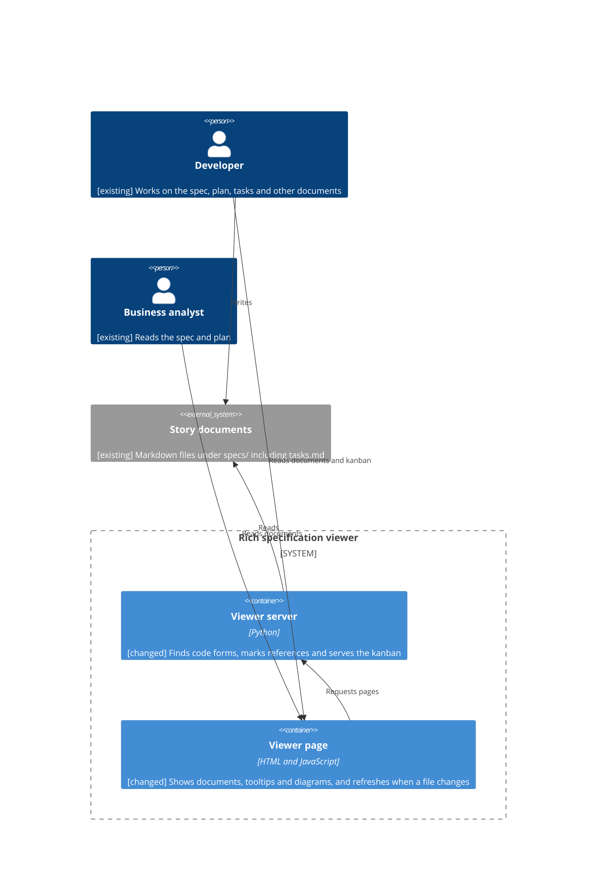
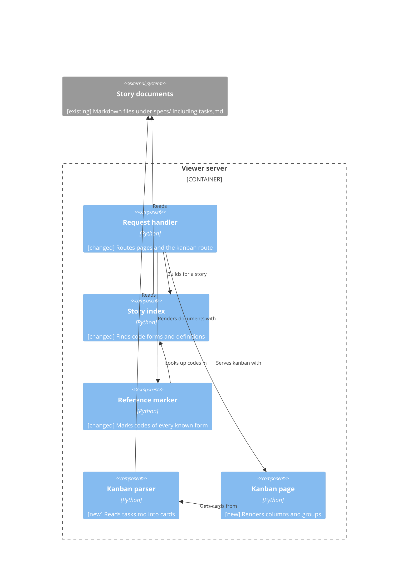
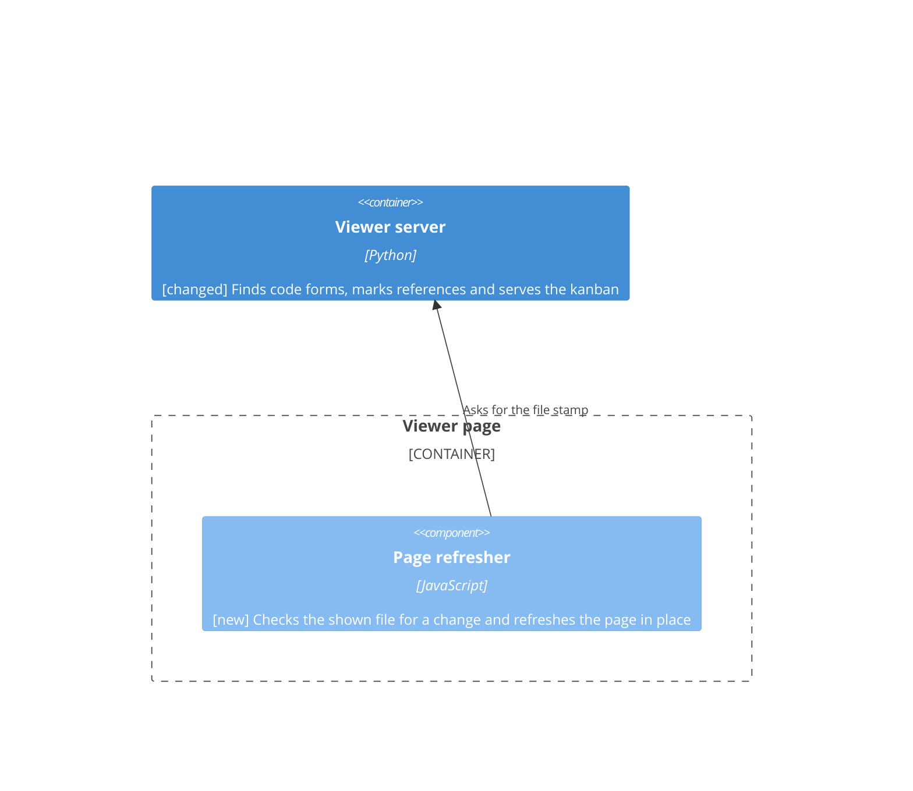
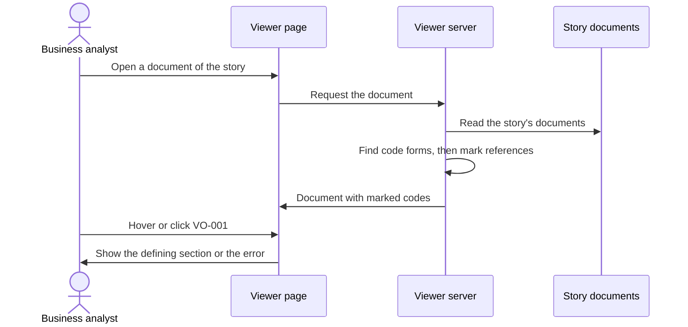
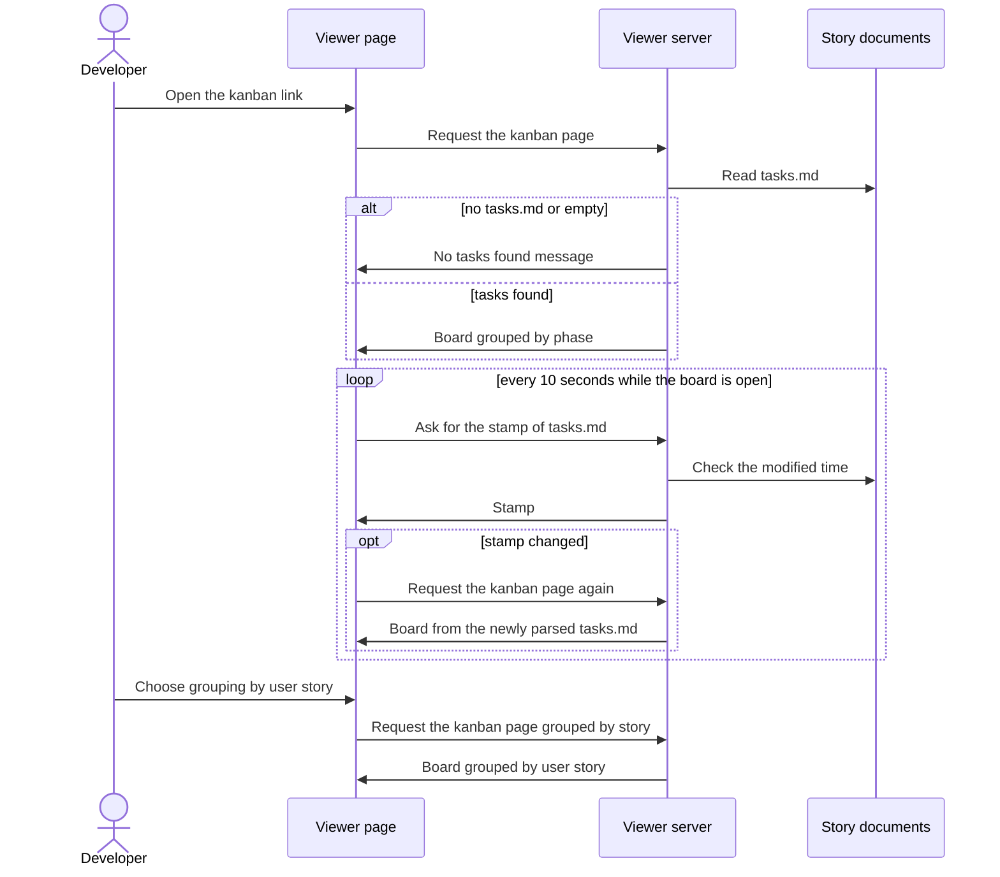

<!--
  STAGE 3 OF THE DEFINITION PIPELINE: HOW will the system do it?

  Gate: TEC-G01 to TEC-G19 (the Technical quality gate). Run `eil check --stage technical`.
  Approval: one recorded confirmation from the responsible developer (or a person named in
  eil-config.yml), after the comprehension check has been taken on this version
  (`/speckit-eil-comprehend`).

  - The developer owns the design. The AI may propose alternatives and challenge decisions; what is
    written as a decision is the developer's choice, and its owner is a person.
  - Every decision traces to the functional or non-functional requirements it serves.
  - Tag any text the AI wrote with [ai-draft] until a human has reviewed it.
  - A section or diagram that does not apply is removed and listed under "Not applicable" with a reason.
-->

# Technical Specification: Cross-reference codes and tasks kanban view

## Technical Requirements

- The viewer keeps running on Python 3.11 or later with only the standard library, started the same way as before (NFR-001; DEC-006 and DEC-007 of story 001).
- The set of recognised code forms for a story is the fixed list plus the prefixes found in that story's own documents, and nothing carries over between stories (FR-004, FR-005, DEC-001).
- The kanban page is built from the saved `tasks.md` on every request and nothing is written to the project (FR-009, NFR-001, DEC-002).
- A story with no `tasks.md`, or an empty one, gets the "no tasks found" message in place of the board (FR-010, DEC-003).
- An open document page or kanban page checks the modified time of the file it shows every 10 seconds and reloads itself when the file has changed. The kanban shows the most recent cached version first (FR-012, NFR-001, DEC-004).

## Architecture

The design stays one Python process, the **Viewer server**, serving pages to the **Viewer page** in the browser (ART-004). Every page of the Viewer page gains a small script that checks for a changed file and refreshes the page (FR-012, DEC-004). Two parts of the server change. The story index gains a first pass that finds the code prefixes a story introduces, and the reference marker then uses that set (DEC-001). A new route, `GET /specs/<story>/kanban`, returns a server-rendered board built from the story's `tasks.md` (DEC-002, DEC-003). Neither change adds a data store, a process or a network dependency.

## Component Design

**Viewer server**:

- **Story index** (changed): before it builds its map of codes to definitions, it makes a pass over each `.md` file of the story at every depth. A code that starts a heading, starts a bullet, or is the only content of the first column of a table row whose next column holds a description, contributes its prefix to the story's set of forms (FR-001, FR-002, FR-005, DEC-001). Its definition rules then use the fixed list plus that set.
- **Reference marker** (changed): marks every code of a discovered form outside inline code and code blocks, with the existing hover, click and error behaviour (FR-003, FR-004).
- **Kanban parser** (new): reads `tasks.md` line by line. A `## ` heading starts a phase. A line matching `- [<mark>] T### …` is a card. The mark and the `(in progress)` and `(blocked)` tags decide the column, with blocked winning over in progress (FR-008, DEC-003). The `[USn]` tag gives the story label and the rest of the line is the description (FR-007).
- **Board cache** (new): holds the parsed cards of each story's `tasks.md` in memory with the file's modified time, and parses again only when that time has changed (DEC-004).
- **Kanban page** (new): renders the four columns, the cards grouped by phase or by user story, and the "no tasks found" message (FR-006, FR-007, FR-010, DEC-002).
- **Request handler** (changed): routes `GET /specs/<story>/kanban[?group=phase|story]` and `GET /api/stamp?path=<path under specs/>` and adds a menu to every page of a story for navigating between its documents and the kanban board (FR-011) (decided: CH-006).

**Viewer page**:

- **Page refresher** (new, on every document page and the kanban page): every 10 seconds asks the server for the stamp of the file the page shows and refreshes the page when the stamp differs from the one it loaded with: a document page keeps the reader's scroll position, and the kanban page keeps the chosen grouping. When the file can no longer be read it keeps the page as it is (FR-012, DEC-004) (decided: CH-012).

## Data Design

See Not applicable.

## API and Integration Design

- `GET /api/stamp?path=<path under specs/>`: JSON `{"stamp": <modified time of that file, or null when it cannot be read>}`, checked by every open document and kanban page every 10 seconds. It goes through the same `Host` check and path guard, so a path outside `specs/` is refused with `403` (FR-012, DEC-004).
- `GET /specs/<story>/kanban`: HTML board grouped by phase. `?group=story` groups by user story and any other value falls back to phase (FR-007, FR-011, DEC-002). Tasks with no phase heading, or with no `[USn]` tag when grouped by user story, go in a group called Unallocated (decided: CH-007).
- Every page of a story carries a menu listing its documents and the kanban board, so the board is reachable from any of them (decided: CH-006).
- Existing routes and their responses do not change. The new route is refused with `403` and `404` in the same cases as every other path (FR-009).
- No new integration. The only external load is still Mermaid from jsDelivr.

## Security Design

- The new route goes through the same `Host` header check and path guard as every other request, so it reads only inside `specs/` below the start folder.
- The kanban view and the discovery pass only read files. Nothing is written (FR-009).
- Task descriptions and story labels come from the Markdown file and are HTML-escaped before they are put on the page.

## Error Handling and Resilience

- A missing, empty or unreadable `tasks.md` shows the "no tasks found" message and does not fail the request (FR-010).
- A line in `tasks.md` that does not match the task pattern is ignored, so one malformed line does not hide the other cards.
- Each request builds its result from the files as they are, so there is nothing to retry, no duplicate-request effect and no state shared between two requests arriving together.

## Observability

No change. The viewer keeps its existing request logging and adds none.

## Performance

Each story page request now scans the story's documents once more to find prefixes. No limit is set for this pass (decided: CH-008). Each open page adds one request every 10 seconds, which only checks a file's modified time (FR-012, DEC-004).

## Testing Strategy

- **Unit**: prefix discovery from a heading, a bullet and a table row, and a back-reference table that must introduce nothing (FR-001, FR-002); the kanban parser for each mark, tag and the blocked-over-in-progress tie (FR-008); grouping by phase and by user story (FR-007).
- **Integration**: a story folder where a code introduced in one document is referenced in another and marked with the hover and click behaviour; the same code in a different story is not marked (FR-003, FR-005); an undefined or ambiguous code of a discovered form shows the error (FR-004).
- **End to end**: request the kanban route for a story with tasks, with an empty `tasks.md` and with none (FR-006, FR-010), and confirm `tasks.md` is unchanged afterwards (FR-009).
- **Refresh**: change a document, or `tasks.md`, while its page is open and confirm the page shows the new content within about 10 seconds with the reader's scroll position (and the board's grouping) kept; leave it unchanged and confirm no reload and, for the board, no re-parse; remove the file and confirm the page keeps its last content (FR-012, NFR-001, DEC-004).
- **Security**: the kanban route refuses a wrong `Host` header and a path outside `specs/`.

## Deployment and Migration

Ship as a change to `specview.py`. There is no data migration or configuration. Rollback is reverting the script.

## Existing System Impact

The story index and the reference marker change, so every story page is now affected by the discovery pass. The fixed prefix list and the existing error behaviour are unchanged (FR-004). Story pages gain a menu to navigate between the story's documents and the kanban board. The README should describe the new view.

## Alternatives Considered

See the rejected alternative of each decision below.

## Risks and Trade-offs

- A bold-looking heading such as `Note-1` or `UTF-8` could introduce a form if it starts a heading or bullet with two or more capital letters, a hyphen and digits. The structural rule limits this, and the effect is only extra reference marking.
- `tasks.md` has no in-progress or blocked marker in the Spec Kit format itself, so those columns stay empty unless the developer adds the `[~]` or `[!]` markers or the tags.
- The task format is read in two places, the kanban parser and the existing task-definition rule, so a change to the format needs both updated.

## Technical Decisions

**DEC-001**: Find a story's code prefixes in a first pass at render time (traces: FR-001, FR-002, FR-003, FR-004, FR-005, NFR-001)
Decision: When a story is indexed, scan its documents for codes that start a heading, a bullet or a qualifying table row, collect their prefixes, and use the fixed list plus those prefixes for definitions and reference marking. The result is rebuilt on every request and nothing is stored.
Reason: A code introduced later in the story is picked up on the next refresh, the result always matches the saved files, and no cache can go stale.
Rejected alternative: Cache the prefixes per story and invalidate them when a file changes, or discover once at server start.
Trade-off: Every page request re-scans the story folder, which is acceptable for story-sized folders.
Owner: Lee Sinclair

**DEC-002**: Serve the kanban as a server-rendered page with a grouping query (traces: FR-006, FR-007, FR-009, FR-011, NFR-001)
Decision: Add a route `GET /specs/<story>/kanban` that reads `tasks.md` on each request and returns finished HTML, grouped by phase by default or by user story with `?group=story`, linked from the story's pages.
Reason: It follows the same render-on-request pattern as every other page, always shows the saved file and writes nothing.
Rejected alternative: A JSON endpoint with a client-side board, or a generated static `kanban.html` file.
Trade-off: Changing the grouping reloads the page.
Owner: Lee Sinclair

**DEC-004**: Show the cached board and refresh every open page when its file changes (traces: FR-006, FR-012, NFR-001)
Decision: The server keeps the parsed cards of each story's `tasks.md` in memory with the file's modified time and parses again only when that time changes. Every open document page and kanban page checks the modified time of the file it shows every 10 seconds and reloads itself when it has changed. A document page keeps the reader's scroll position after the refresh, and the kanban board refreshes in place and keeps its grouping.
Reason: The board shows the most recent version straight away, and any open page picks up an edit to its file within about 10 seconds, with only a cheap date check each time.
Rejected alternative: Re-read and re-parse `tasks.md` on every request with no automatic refresh, or set a response-time limit and leave the page to be refreshed by hand.
Trade-off: Every page runs a small script and polls the server every 10 seconds while open, an edit can take up to 10 seconds to show, and keeping the scroll position needs a little more script on the page.
Owner: Lee Sinclair

**DEC-003**: Parse `tasks.md` with a dedicated line parser (traces: FR-006, FR-007, FR-008, FR-010)
Decision: Read `tasks.md` line by line in a small parser separate from the Markdown renderer. A `## ` heading starts a phase, a `- [mark] T### …` line is a card, the mark and `(in progress)` or `(blocked)` tags decide the column with blocked winning, and the `[USn]` tag gives the story label.
Reason: It extracts the fields directly, without depending on how the renderer treats lists.
Rejected alternative: Reuse the renderer's list tokens, or treat `tasks.md` as a table or YAML.
Trade-off: The task format is read in two places, so a change to it needs both updated.
Owner: Lee Sinclair

## Container View

**ART-004**: Containers of the viewer (traces: FR-003, FR-006, FR-012, DEC-001, DEC-002, DEC-004)



## Component Views

**ART-005**: Inside the viewer server (traces: FR-003, FR-006, DEC-001, DEC-003)



**ART-008**: Inside the viewer page (traces: FR-012, DEC-004)



## Sequence Diagrams

**ART-006**: Business analyst follows a newly introduced code (traces: UC-001, DEC-001)



**ART-007**: Developer checks build progress (traces: UC-002, DEC-002, DEC-003, DEC-004)



## Data Model

See Not applicable.

## Not applicable

- Data Design: the viewer stores nothing, and the prefixes and cards are rebuilt from the files on every request.
- Data Model: no persistent data is added or changed.

## Challenges

<!-- Recorded by `eil challenge`. -->

```eil:challenge
{
  "id": "CH-006",
  "stage": "technical",
  "raised_by": "ai",
  "raised_at": "2026-10-16T22:51:25Z",
  "target": "FR-011",
  "text": "Component Design says the request handler adds a kanban link on the story's pages, but not which pages: the story folder listing only, or also every document page of the story. Decide where the link appears and state it in the Request handler component and the API section.",
  "status": "closed",
  "severity": "medium",
  "responder": "Lee Sinclair",
  "response": "accepted",
  "at": "2026-10-16T22:55:48Z",
  "reason": "it should be available from the other pages in the story, so the viewer needs a menu to navigate between documents and the kanban board"
}
```

```eil:challenge
{
  "id": "CH-007",
  "stage": "technical",
  "raised_by": "ai",
  "raised_at": "2026-10-16T22:51:25Z",
  "target": "DEC-003",
  "text": "DEC-003 does not say where a task goes when it has no phase heading above it, or has no [USn] tag when grouped by user story, nor which heading levels start a phase. FR-007 requires grouping by phase or user story, so the ungrouped case needs a defined group (for example 'No phase' and 'No user story') or a rule.",
  "status": "closed",
  "severity": "medium",
  "responder": "Lee Sinclair",
  "response": "accepted",
  "at": "2026-10-16T22:55:48Z",
  "reason": "add them to an unallocated group of tasks"
}
```

```eil:challenge
{
  "id": "CH-008",
  "stage": "technical",
  "raised_by": "ai",
  "raised_at": "2026-10-16T22:51:25Z",
  "target": "Performance",
  "text": "The Performance section sets no limit or test for the extra discovery pass per request (it says 'not expected to be noticeable'), so it cannot be verified. Either give a number of documents and a response time to check, or record that no limit is set and accept the risk.",
  "status": "closed",
  "severity": "low",
  "responder": "Lee Sinclair",
  "response": "accepted",
  "at": "2026-10-17T00:00:25Z",
  "reason": "A with cache to show the most recent version and then within a small amount of time it's refreshed"
}
```

```eil:challenge
{
  "id": "CH-009",
  "stage": "technical",
  "raised_by": "ai",
  "raised_at": "2026-10-17T00:00:53Z",
  "target": "DEC-004",
  "text": "DEC-004 adds an automatic refresh every 10 seconds, but the approved NFR-001 only says the kanban shows the saved tasks.md when the page is refreshed, and no FR or REQ asks for the board to update itself. Either amend the functional/non-functional text (and requirements) to state the automatic refresh and its interval, or accept the decision as a technical addition that no approved requirement covers.",
  "status": "closed",
  "severity": "medium",
  "responder": "Lee Sinclair",
  "response": "accepted",
  "at": "2026-10-17T00:19:30Z",
  "reason": "Let's amend it so that all the docs autorefesh if there is a change in the file timestamp"
}
```

```eil:challenge
{
  "id": "CH-012",
  "stage": "technical",
  "raised_by": "ai",
  "raised_at": "2026-10-17T02:35:52Z",
  "target": "DEC-004",
  "text": "DEC-004 and the Page refresher reload the whole page when the file's modified time changes, but do not say what happens to the reader's position. A reload of a document page returns the reader to the top of the document while they are mid-review. State whether a document page keeps the reader's scroll position (or reloads in place) after a refresh, and whether the kanban board is treated differently.",
  "status": "closed",
  "severity": "medium",
  "responder": "Lee Sinclair",
  "response": "accepted",
  "at": "2026-10-17T02:41:07Z",
  "reason": "yes"
}
```

## Overrides

<!-- Recorded by `eil override`, each naming who, what and why. -->

## Change Log

<!-- eil:begin changelog -->
<!-- eil:end changelog -->

## Record

<!-- eil:begin provenance -->
```json
{
  "version": 1,
  "blocks": {
    "DEC-001": {
      "hash": "sha256:13a2732b598fcb0a7a620f1cc017318a750024235d9ca1453803f7f35b0ddedd",
      "class": "restated",
      "cites": {
        "FR-001": "sha256:383f9296ff6a52d4e4c18607d174c816a95c9866b401c32d2b1194eb13a9b02c",
        "FR-002": "sha256:ed7dcf7ed5c6ad99f53a01c0ec96df80de21351bd839845b0ed6f1eef2a95ac7",
        "FR-003": "sha256:6f18dad4de22e5bf0feddcabd830ff23d873cb8dbf764edb96567d43b43cd668",
        "FR-004": "sha256:2ae3eb4329aaec539cf2ad43395016234b0a1d74b69470992d5519897e9b382f",
        "FR-005": "sha256:4fd4014add1830d59d7445913099f5dd61577b4ec75fcd6902f24418f440d04d",
        "NFR-001": "sha256:3131ccae52047de8b10a4105b89cdfc6b05b5b23f14b57040ff773ac24431f08"
      }
    },
    "DEC-002": {
      "hash": "sha256:450de9b1737c8d785caca57c0b3cc522aed8898e9dcea2c8c953f697e1d03aa3",
      "class": "restated",
      "cites": {
        "FR-006": "sha256:81abe569717adc55e2ea4a635ebadcc9268825b269a820b6259f8c2d3580709a",
        "FR-007": "sha256:a1b8235dbe5caad9d3c19f5344e9e629dfe07c2ba8ee6f358a2296174454ae28",
        "FR-009": "sha256:2f4e357e7c45afc0535ca51280ef4a6cb662efea2c188887a76a8e0bbf79f79c",
        "FR-011": "sha256:faf836f7ec7f293517c93343e6f61f8d0ff39875f6a9c4fcf4e570f136a028ec",
        "NFR-001": "sha256:3131ccae52047de8b10a4105b89cdfc6b05b5b23f14b57040ff773ac24431f08"
      }
    },
    "DEC-003": {
      "hash": "sha256:a9f99d3c520b3fe486f6f8103e542d28fb3a7c31a82c82665be1893726556d9d",
      "class": "restated",
      "cites": {
        "FR-006": "sha256:81abe569717adc55e2ea4a635ebadcc9268825b269a820b6259f8c2d3580709a",
        "FR-007": "sha256:a1b8235dbe5caad9d3c19f5344e9e629dfe07c2ba8ee6f358a2296174454ae28",
        "FR-008": "sha256:b5f49e91e9db1d61276c75c1959d4e30f9d2a96b7a5354e4bf23c554d7e6fcab",
        "FR-010": "sha256:f297709714ffd46f93f7abf23c9ebea1294efd150bd16b280ccbcedbc0bffd3c"
      }
    },
    "ART-004": {
      "hash": "sha256:4b39c4b13aeb75a9f406bf14f4086f90145e8c067318a8d9c7117bc59ad99bed",
      "class": "inferred",
      "adds": "draws the containers implied by the decisions",
      "reviewed": {
        "by": "Lee Sinclair",
        "at": "2026-10-17T02:21:22Z",
        "list": "RVW-007",
        "reply": "yes approve first group; yes approve group 2; yes approve group 3"
      }
    },
    "ART-005": {
      "hash": "sha256:ddc99a0e777eeefe57010caa1355dd2acd061ede1711db2f440d2a061dbb0e06",
      "class": "inferred",
      "adds": "draws the components implied by the decisions",
      "reviewed": {
        "by": "Lee Sinclair",
        "at": "2026-10-17T02:21:22Z",
        "list": "RVW-007",
        "reply": "yes approve first group; yes approve group 2; yes approve group 3"
      }
    },
    "ART-006": {
      "hash": "sha256:295316b3f91e78fc07ccec63c7dc4ff5d3e4e70575de34d2bb3fc5bb198878b5",
      "class": "inferred",
      "adds": "draws the flow of UC-001 across containers",
      "reviewed": {
        "by": "Lee Sinclair",
        "at": "2026-10-17T02:21:22Z",
        "list": "RVW-007",
        "reply": "yes approve first group; yes approve group 2; yes approve group 3"
      }
    },
    "ART-007": {
      "hash": "sha256:e235f1fce07d44c485bfb4c27d046a24339b14a74bb0da9185ddd1d23a0826f6",
      "class": "inferred",
      "adds": "draws the flow of UC-002 across containers",
      "reviewed": {
        "by": "Lee Sinclair",
        "at": "2026-10-17T02:21:22Z",
        "list": "RVW-007",
        "reply": "yes approve first group; yes approve group 2; yes approve group 3"
      }
    },
    "DEC-004": {
      "hash": "sha256:942ab4072dd367c7cc88758bbd6df350e7ce92e76ea93688853324c207fbf0a3",
      "class": "inferred",
      "reviewed": {
        "by": "Lee Sinclair",
        "at": "2026-10-17T02:48:53Z",
        "list": "RVW-008",
        "reply": "group 1 yes"
      }
    },
    "ART-008": {
      "hash": "sha256:952782963b9d2dcd8083c0acbf50df86010fad0435552f9058625f9c8d4feb51",
      "class": "inferred",
      "adds": "draws the page component implied by DEC-004",
      "reviewed": {
        "by": "Lee Sinclair",
        "at": "2026-10-17T02:48:53Z",
        "list": "RVW-008",
        "reply": "group 1 yes"
      }
    },
    "Technical Requirements#8d4e4d9d9491": {
      "hash": "sha256:8d4e4d9d9491ac0ae5477d59df1a27f72b26c04d8ecc3d810f3fe501edfa2408",
      "reviewed": {
        "by": "Lee Sinclair",
        "at": "2026-10-17T02:21:22Z",
        "list": "RVW-007",
        "reply": "yes approve first group; yes approve group 2; yes approve group 3"
      },
      "class": "inferred"
    },
    "Architecture#de0fbdac0fe4": {
      "hash": "sha256:de0fbdac0fe42bb0095ceb3cd74da748f0d416a8bbb433ae83e9793e8a289dbe",
      "reviewed": {
        "by": "Lee Sinclair",
        "at": "2026-10-17T02:21:22Z",
        "list": "RVW-007",
        "reply": "yes approve first group; yes approve group 2; yes approve group 3"
      },
      "class": "inferred"
    },
    "Component Design#960eb0e5f78a": {
      "hash": "sha256:960eb0e5f78a8fcdc3d7da8f49afb67ee483fbf26f01334ec7f869684f44156f",
      "reviewed": {
        "by": "Lee Sinclair",
        "at": "2026-10-17T02:21:22Z",
        "list": "RVW-007",
        "reply": "yes approve first group; yes approve group 2; yes approve group 3"
      },
      "class": "inferred"
    },
    "Component Design#5418e4e30492": {
      "hash": "sha256:5418e4e30492273ae550a2271b8685011ec91e9243a31acb15fa92d1cddd46f4",
      "reviewed": {
        "by": "Lee Sinclair",
        "at": "2026-10-17T02:21:22Z",
        "list": "RVW-007",
        "reply": "yes approve first group; yes approve group 2; yes approve group 3"
      },
      "class": "inferred"
    },
    "Component Design#6318a367f177": {
      "hash": "sha256:6318a367f177ac1fafc2b08cd8a2b28c09a59e9504783b5dc69622ca2205857e",
      "reviewed": {
        "by": "Lee Sinclair",
        "at": "2026-10-17T02:21:22Z",
        "list": "RVW-007",
        "reply": "yes approve first group; yes approve group 2; yes approve group 3"
      },
      "class": "inferred"
    },
    "Component Design#79bfed3107b4": {
      "hash": "sha256:79bfed3107b4893fcfbd249794a05d3390c5f8b1dd922a57234d81674f30a8ca",
      "reviewed": {
        "by": "Lee Sinclair",
        "at": "2026-10-17T02:21:22Z",
        "list": "RVW-007",
        "reply": "yes approve first group; yes approve group 2; yes approve group 3"
      },
      "class": "inferred"
    },
    "Data Design#2dca997923a8": {
      "hash": "sha256:2dca997923a838ec5330269645261001dd2212bd00215f1f33d09536bd631ee7",
      "reviewed": {
        "by": "Lee Sinclair",
        "at": "2026-10-17T02:21:22Z",
        "list": "RVW-007",
        "reply": "yes approve first group; yes approve group 2; yes approve group 3"
      },
      "class": "inferred"
    },
    "API and Integration Design#195a448e5ece": {
      "hash": "sha256:195a448e5ecef516bcdbcf21bb996afe16dd02daf905e2954058273ceb7f14ee",
      "reviewed": {
        "by": "Lee Sinclair",
        "at": "2026-10-17T02:21:22Z",
        "list": "RVW-007",
        "reply": "yes approve first group; yes approve group 2; yes approve group 3"
      },
      "class": "inferred"
    },
    "Security Design#cf5d44974086": {
      "hash": "sha256:cf5d449740869127ac5434b40cd55056605533ead44fa5e42865f6d8e724f0ac",
      "reviewed": {
        "by": "Lee Sinclair",
        "at": "2026-10-17T02:21:22Z",
        "list": "RVW-007",
        "reply": "yes approve first group; yes approve group 2; yes approve group 3"
      },
      "class": "inferred"
    },
    "Error Handling and Resilience#b8874902d6b9": {
      "hash": "sha256:b8874902d6b9fcd3e9f4d877d111030c64c329a2dd8cae0f1b847980852186e2",
      "reviewed": {
        "by": "Lee Sinclair",
        "at": "2026-10-17T02:21:22Z",
        "list": "RVW-007",
        "reply": "yes approve first group; yes approve group 2; yes approve group 3"
      },
      "class": "inferred"
    },
    "Observability#d27b5bc6d13e": {
      "hash": "sha256:d27b5bc6d13e378f687c135e1b3f146b74acb9ba371fc52660d6aa224379a3fc",
      "reviewed": {
        "by": "Lee Sinclair",
        "at": "2026-10-17T02:21:22Z",
        "list": "RVW-007",
        "reply": "yes approve first group; yes approve group 2; yes approve group 3"
      },
      "class": "inferred"
    },
    "Performance#11b39ca794b8": {
      "hash": "sha256:11b39ca794b8e468f6c31cc8488ed25a4fdd3f3ef76290dc57ece1abd43ac0f6",
      "reviewed": {
        "by": "Lee Sinclair",
        "at": "2026-10-17T02:21:22Z",
        "list": "RVW-007",
        "reply": "yes approve first group; yes approve group 2; yes approve group 3"
      },
      "class": "inferred"
    },
    "Testing Strategy#9c32e30ed6ed": {
      "hash": "sha256:9c32e30ed6edc2803e88e5f8f0e0499a1feb48ce1ae30bc0d78b746593455677",
      "reviewed": {
        "by": "Lee Sinclair",
        "at": "2026-10-17T02:21:22Z",
        "list": "RVW-007",
        "reply": "yes approve first group; yes approve group 2; yes approve group 3"
      },
      "class": "inferred"
    },
    "Deployment and Migration#4c2a23c16956": {
      "hash": "sha256:4c2a23c16956d98dcb97e4e0fc9e41128b40060aa14b3d72562ac01f67fdbc36",
      "reviewed": {
        "by": "Lee Sinclair",
        "at": "2026-10-17T02:21:22Z",
        "list": "RVW-007",
        "reply": "yes approve first group; yes approve group 2; yes approve group 3"
      },
      "class": "inferred"
    },
    "Existing System Impact#62499f8ae4f6": {
      "hash": "sha256:62499f8ae4f6ab4ba370195cb5853f2b03ccb6aadae659a5eab9954ffe6211e0",
      "reviewed": {
        "by": "Lee Sinclair",
        "at": "2026-10-17T02:21:22Z",
        "list": "RVW-007",
        "reply": "yes approve first group; yes approve group 2; yes approve group 3"
      },
      "class": "inferred"
    },
    "Alternatives Considered#fdd96581d5af": {
      "hash": "sha256:fdd96581d5afcc10fa3b5eb116a8262bc2a703ec46b4c2d4b79158468815de04",
      "reviewed": {
        "by": "Lee Sinclair",
        "at": "2026-10-17T02:21:22Z",
        "list": "RVW-007",
        "reply": "yes approve first group; yes approve group 2; yes approve group 3"
      },
      "class": "inferred"
    },
    "Risks and Trade-offs#e2b27df4e489": {
      "hash": "sha256:e2b27df4e4899c01cd9c0849226b7cdb8ced18a4a0962e437b17f54edc3461ca",
      "reviewed": {
        "by": "Lee Sinclair",
        "at": "2026-10-17T02:21:22Z",
        "list": "RVW-007",
        "reply": "yes approve first group; yes approve group 2; yes approve group 3"
      },
      "class": "inferred"
    },
    "Data Model#2dca997923a8": {
      "hash": "sha256:2dca997923a838ec5330269645261001dd2212bd00215f1f33d09536bd631ee7",
      "reviewed": {
        "by": "Lee Sinclair",
        "at": "2026-10-17T02:21:22Z",
        "list": "RVW-007",
        "reply": "yes approve first group; yes approve group 2; yes approve group 3"
      },
      "class": "inferred"
    },
    "Not applicable#5f799e266937": {
      "hash": "sha256:5f799e2669376fa11036bd2de59c9c923dfbbb5ebc3c2d7afff11ab6c68d02ad",
      "reviewed": {
        "by": "Lee Sinclair",
        "at": "2026-10-17T02:21:22Z",
        "list": "RVW-007",
        "reply": "yes approve first group; yes approve group 2; yes approve group 3"
      },
      "class": "inferred"
    },
    "Architecture#07189866ff04": {
      "hash": "sha256:07189866ff049eaa71e9977162369cf226a72904dda3eef0ea1f1142b8a88167",
      "reviewed": {
        "by": "Lee Sinclair",
        "at": "2026-10-17T02:48:53Z",
        "list": "RVW-008",
        "reply": "group 1 yes"
      },
      "class": "inferred"
    },
    "Component Design#234137962720": {
      "hash": "sha256:234137962720e024d4428cf66e5e70a725fe657c6fd913d00cbe8bafeaa2972a",
      "reviewed": {
        "by": "Lee Sinclair",
        "at": "2026-10-17T02:48:53Z",
        "list": "RVW-008",
        "reply": "group 1 yes"
      },
      "class": "inferred"
    },
    "Testing Strategy#0642d364036e": {
      "hash": "sha256:0642d364036e3e624d0b88847aeece4a582f5f9b56478dc8f824f41335bb2a1f",
      "reviewed": {
        "by": "Lee Sinclair",
        "at": "2026-10-17T02:48:53Z",
        "list": "RVW-008",
        "reply": "group 1 yes"
      },
      "class": "inferred"
    }
  },
  "acceptances": [
    {
      "id": "RVW-007",
      "stage": "technical",
      "kind": "inferred",
      "digest": "sha256:4dd3e88fe417b7f78d02ad95dec79fe706eb355cd6129ae54b31c19f35ea5ff0",
      "by": "Lee Sinclair",
      "at": "2026-10-17T02:21:22Z",
      "reply": "yes approve first group; yes approve group 2; yes approve group 3",
      "accepted": [
        "Technical Requirements#8d4e4d9d9491",
        "Architecture#de0fbdac0fe4",
        "Component Design#960eb0e5f78a",
        "Component Design#5418e4e30492",
        "Component Design#6318a367f177",
        "Component Design#79bfed3107b4",
        "Data Design#2dca997923a8",
        "API and Integration Design#195a448e5ece",
        "Security Design#cf5d44974086",
        "Error Handling and Resilience#b8874902d6b9",
        "Observability#d27b5bc6d13e",
        "Performance#11b39ca794b8",
        "Testing Strategy#9c32e30ed6ed",
        "Deployment and Migration#4c2a23c16956",
        "Existing System Impact#62499f8ae4f6",
        "Alternatives Considered#fdd96581d5af",
        "Risks and Trade-offs#e2b27df4e489",
        "ART-004",
        "ART-005",
        "ART-008",
        "ART-006",
        "ART-007",
        "Data Model#2dca997923a8",
        "Not applicable#5f799e266937"
      ],
      "except": [],
      "questioned": [],
      "reopened": [],
      "reason": null,
      "hashes": {
        "Technical Requirements#8d4e4d9d9491": "sha256:8d4e4d9d9491ac0ae5477d59df1a27f72b26c04d8ecc3d810f3fe501edfa2408",
        "Architecture#de0fbdac0fe4": "sha256:de0fbdac0fe42bb0095ceb3cd74da748f0d416a8bbb433ae83e9793e8a289dbe",
        "Component Design#960eb0e5f78a": "sha256:960eb0e5f78a8fcdc3d7da8f49afb67ee483fbf26f01334ec7f869684f44156f",
        "Component Design#5418e4e30492": "sha256:5418e4e30492273ae550a2271b8685011ec91e9243a31acb15fa92d1cddd46f4",
        "Component Design#6318a367f177": "sha256:6318a367f177ac1fafc2b08cd8a2b28c09a59e9504783b5dc69622ca2205857e",
        "Component Design#79bfed3107b4": "sha256:79bfed3107b4893fcfbd249794a05d3390c5f8b1dd922a57234d81674f30a8ca",
        "Data Design#2dca997923a8": "sha256:2dca997923a838ec5330269645261001dd2212bd00215f1f33d09536bd631ee7",
        "API and Integration Design#195a448e5ece": "sha256:195a448e5ecef516bcdbcf21bb996afe16dd02daf905e2954058273ceb7f14ee",
        "Security Design#cf5d44974086": "sha256:cf5d449740869127ac5434b40cd55056605533ead44fa5e42865f6d8e724f0ac",
        "Error Handling and Resilience#b8874902d6b9": "sha256:b8874902d6b9fcd3e9f4d877d111030c64c329a2dd8cae0f1b847980852186e2",
        "Observability#d27b5bc6d13e": "sha256:d27b5bc6d13e378f687c135e1b3f146b74acb9ba371fc52660d6aa224379a3fc",
        "Performance#11b39ca794b8": "sha256:11b39ca794b8e468f6c31cc8488ed25a4fdd3f3ef76290dc57ece1abd43ac0f6",
        "Testing Strategy#9c32e30ed6ed": "sha256:9c32e30ed6edc2803e88e5f8f0e0499a1feb48ce1ae30bc0d78b746593455677",
        "Deployment and Migration#4c2a23c16956": "sha256:4c2a23c16956d98dcb97e4e0fc9e41128b40060aa14b3d72562ac01f67fdbc36",
        "Existing System Impact#62499f8ae4f6": "sha256:62499f8ae4f6ab4ba370195cb5853f2b03ccb6aadae659a5eab9954ffe6211e0",
        "Alternatives Considered#fdd96581d5af": "sha256:fdd96581d5afcc10fa3b5eb116a8262bc2a703ec46b4c2d4b79158468815de04",
        "Risks and Trade-offs#e2b27df4e489": "sha256:e2b27df4e4899c01cd9c0849226b7cdb8ced18a4a0962e437b17f54edc3461ca",
        "ART-004": "sha256:4b39c4b13aeb75a9f406bf14f4086f90145e8c067318a8d9c7117bc59ad99bed",
        "ART-005": "sha256:ddc99a0e777eeefe57010caa1355dd2acd061ede1711db2f440d2a061dbb0e06",
        "ART-008": "sha256:1389790726f1ac708dd9e5a7160966988f49b5f13ecc5d8224e22caef1e0da03",
        "ART-006": "sha256:295316b3f91e78fc07ccec63c7dc4ff5d3e4e70575de34d2bb3fc5bb198878b5",
        "ART-007": "sha256:e235f1fce07d44c485bfb4c27d046a24339b14a74bb0da9185ddd1d23a0826f6",
        "Data Model#2dca997923a8": "sha256:2dca997923a838ec5330269645261001dd2212bd00215f1f33d09536bd631ee7",
        "Not applicable#5f799e266937": "sha256:5f799e2669376fa11036bd2de59c9c923dfbbb5ebc3c2d7afff11ab6c68d02ad"
      }
    },
    {
      "id": "RVW-008",
      "stage": "technical",
      "kind": "inferred",
      "digest": "sha256:f8f32ccfa13a930d9d664966abe654ec841ca6418556a6a452cbb88e9638822f",
      "by": "Lee Sinclair",
      "at": "2026-10-17T02:48:53Z",
      "reply": "group 1 yes",
      "accepted": [
        "Architecture#07189866ff04",
        "Component Design#234137962720",
        "Testing Strategy#0642d364036e",
        "DEC-004",
        "ART-008"
      ],
      "except": [],
      "questioned": [],
      "reopened": [],
      "reason": null,
      "hashes": {
        "Architecture#07189866ff04": "sha256:07189866ff049eaa71e9977162369cf226a72904dda3eef0ea1f1142b8a88167",
        "Component Design#234137962720": "sha256:234137962720e024d4428cf66e5e70a725fe657c6fd913d00cbe8bafeaa2972a",
        "Testing Strategy#0642d364036e": "sha256:0642d364036e3e624d0b88847aeece4a582f5f9b56478dc8f824f41335bb2a1f",
        "DEC-004": "sha256:942ab4072dd367c7cc88758bbd6df350e7ce92e76ea93688853324c207fbf0a3",
        "ART-008": "sha256:952782963b9d2dcd8083c0acbf50df86010fad0435552f9058625f9c8d4feb51"
      }
    }
  ]
}
```
<!-- eil:end provenance -->

## Comprehension Check

<!-- The record of the check taken on this version: levels, outcomes, attempts and item ids only. Never a question, an answer, a hint or a score. -->

<!-- eil:begin comprehension -->
```json
{
  "stage": "technical",
  "fingerprint": "sha256:5e4d4481399e0f510e1eeccd16127fd29643d762857c7fbd36cc976a8f1dc790",
  "taken_by": "Lee Sinclair",
  "started_at": "2026-10-17T02:49:14Z",
  "updated_at": "2026-10-17T02:49:15Z",
  "levels": [
    {
      "level": "recognise",
      "outcome": "skipped",
      "attempts": 0,
      "items": [
        "DEC-004"
      ]
    },
    {
      "level": "explain",
      "outcome": "skipped",
      "attempts": 0,
      "items": [
        "DEC-004"
      ]
    },
    {
      "level": "apply",
      "outcome": "skipped",
      "attempts": 0,
      "items": [
        "DEC-004"
      ]
    },
    {
      "level": "trace",
      "outcome": "skipped",
      "attempts": 0,
      "items": [
        "DEC-004"
      ]
    },
    {
      "level": "evaluate",
      "outcome": "skipped",
      "attempts": 0,
      "items": [
        "DEC-004"
      ]
    }
  ]
}
```
<!-- eil:end comprehension -->

## Quality Assessment

<!-- eil:begin assessment -->
```json
{
  "stage": "technical",
  "evaluated_at": "2026-10-17T02:49:15Z",
  "fingerprint": "sha256:5e4d4481399e0f510e1eeccd16127fd29643d762857c7fbd36cc976a8f1dc790",
  "criteria": [
    {
      "id": "TEC-G01",
      "kind": "judgment",
      "status": "met",
      "reason": "AI assessment: Every FR and NFR, including FR-012 and the page refresh, is served by DEC-001 to DEC-004 and the components.",
      "basis": "sha256:7dd1c05a7a4200ee91b1a1546c5eeb752aa19eff3507fe0a2721b306f131d5bd"
    },
    {
      "id": "TEC-G02",
      "kind": "traceability",
      "status": "met",
      "reason": ""
    },
    {
      "id": "TEC-G03",
      "kind": "structural",
      "status": "met",
      "reason": ""
    },
    {
      "id": "TEC-G04",
      "kind": "structural",
      "status": "met",
      "reason": ""
    },
    {
      "id": "TEC-G05",
      "kind": "structural",
      "status": "met",
      "reason": ""
    },
    {
      "id": "TEC-G06",
      "kind": "structural",
      "status": "met",
      "reason": ""
    },
    {
      "id": "TEC-G07",
      "kind": "structural",
      "status": "met",
      "reason": ""
    },
    {
      "id": "TEC-G08",
      "kind": "judgment",
      "status": "met",
      "reason": "AI assessment: Unit, integration, end-to-end, refresh and security tests cover each decision and the FRs they trace to.",
      "basis": "sha256:d2426e696cf8c9712137cb1b3e6dd6dc6456570739c626f2474736c089d06417"
    },
    {
      "id": "TEC-G09",
      "kind": "structural",
      "status": "met",
      "reason": ""
    },
    {
      "id": "TEC-G10",
      "kind": "structural",
      "status": "met",
      "reason": ""
    },
    {
      "id": "TEC-G11",
      "kind": "structural",
      "status": "met",
      "reason": ""
    },
    {
      "id": "TEC-G12",
      "kind": "traceability",
      "status": "met",
      "reason": ""
    },
    {
      "id": "TEC-G13",
      "kind": "judgment",
      "status": "met",
      "reason": "AI assessment: The design reuses the render-on-request server, path guard, Host check and in-memory cache pattern of story 001.",
      "basis": "sha256:5e4d4481399e0f510e1eeccd16127fd29643d762857c7fbd36cc976a8f1dc790"
    },
    {
      "id": "TEC-G14",
      "kind": "judgment",
      "status": "met",
      "reason": "AI assessment: Four decisions, three diagrams per level and a component view give a short traceable account of how and why.",
      "basis": "sha256:5e4d4481399e0f510e1eeccd16127fd29643d762857c7fbd36cc976a8f1dc790"
    },
    {
      "id": "TEC-G15",
      "kind": "structural",
      "status": "met",
      "reason": ""
    },
    {
      "id": "TEC-G16",
      "kind": "structural",
      "status": "met",
      "reason": ""
    },
    {
      "id": "TEC-G17",
      "kind": "structural",
      "status": "met",
      "reason": ""
    },
    {
      "id": "TEC-G18",
      "kind": "structural",
      "status": "met",
      "reason": ""
    },
    {
      "id": "TEC-G19",
      "kind": "structural",
      "status": "met",
      "reason": ""
    }
  ],
  "assessment": {
    "ambiguity": [
      "Which heading levels start a phase in tasks.md is stated only as '## '."
    ],
    "missing": [],
    "contradictions": [],
    "unsupported_assumptions": [],
    "untestable": []
  },
  "findings": []
}
```
<!-- eil:end assessment -->

## Approval

<!-- eil:begin approval -->
```json
{
  "stage": "technical",
  "by": "Lee Sinclair",
  "at": "2026-10-17T02:52:32Z",
  "fingerprint": "sha256:5e4d4481399e0f510e1eeccd16127fd29643d762857c7fbd36cc976a8f1dc790",
  "reached": "first",
  "attestation": "approve, Lee Siclair",
  "upstream": {
    "requirements": "sha256:5dc8e9debe4a7a06f5aff70aff530c6e314e2738d41b3b434f7a1c61e88339fb",
    "functional": "sha256:61a93249c941079351d5a5b82ba59726ae510316e7dcd4206d886076fcb2a7cf"
  },
  "items": {
    "DEC-001": "sha256:13a2732b598fcb0a7a620f1cc017318a750024235d9ca1453803f7f35b0ddedd",
    "DEC-002": "sha256:450de9b1737c8d785caca57c0b3cc522aed8898e9dcea2c8c953f697e1d03aa3",
    "DEC-004": "sha256:942ab4072dd367c7cc88758bbd6df350e7ce92e76ea93688853324c207fbf0a3",
    "DEC-003": "sha256:a9f99d3c520b3fe486f6f8103e542d28fb3a7c31a82c82665be1893726556d9d",
    "ART-004": "sha256:4b39c4b13aeb75a9f406bf14f4086f90145e8c067318a8d9c7117bc59ad99bed",
    "ART-005": "sha256:ddc99a0e777eeefe57010caa1355dd2acd061ede1711db2f440d2a061dbb0e06",
    "ART-008": "sha256:952782963b9d2dcd8083c0acbf50df86010fad0435552f9058625f9c8d4feb51",
    "ART-006": "sha256:295316b3f91e78fc07ccec63c7dc4ff5d3e4e70575de34d2bb3fc5bb198878b5",
    "ART-007": "sha256:e235f1fce07d44c485bfb4c27d046a24339b14a74bb0da9185ddd1d23a0826f6"
  },
  "section_fingerprints": {
    "Technical Requirements": "sha256:87754330519be3cd712db843fd38c327b7c4c04abe9fa79d51d211179df74433",
    "Architecture": "sha256:c9c8e7ef27bb362499ea708be33f385f1c070f90019e5e446f3e6cdbb8d62555",
    "Component Design": "sha256:a3ca2a19d8996c1dc04d593697b72feaeea2e73d7bf42b8c1fea281126e791c2",
    "Data Design": "sha256:ff7b565119115db6071df96c43b01b122890dd179c733eacf809cebebefa5d24",
    "API and Integration Design": "sha256:46922fc7867e7884f0e9c761962bd2fc405ab11be21c7ab664d9764c3cb65101",
    "Security Design": "sha256:d7a613a9357d242fcbf43e27f0054812916fa2ad7a3f9270bd7f4ad5c6482510",
    "Error Handling and Resilience": "sha256:90f5686562539e360de57289ccfb8002be5f6368fe90bf0e525d2f3ee6a31d02",
    "Observability": "sha256:aca0972573a60a22faf4b9d284aed69623353b9470b441ada85e41ba34b25907",
    "Performance": "sha256:80f85be1740397ca9b930fe2af46d46792888a184bd458b500447085315eaec4",
    "Testing Strategy": "sha256:3ed8da1b3d82da520b4c5c67b81b4b4a4dce32a095ce569a4b0c3ab6c237f4a4",
    "Deployment and Migration": "sha256:88ecd8ba7aad5d854e043a53da5718ffd183bc0783770c75f07880e96ca566ce",
    "Existing System Impact": "sha256:432c06973fdfeb2a6ecb4e3aee1eb84ca999127eac75d42254d0b91d0a56b3d6",
    "Alternatives Considered": "sha256:be9babf7ffa6a934b02a8d58398edebe840412f5b54bbc91f2486aea8f53f900",
    "Risks and Trade-offs": "sha256:62fe40b8610030318984915a404b18c45500cd01103037e598e8f62f67178543",
    "Technical Decisions": "sha256:345283af75468d07ba7d7be8678f8cc3588d0997550399534dd5eb0980d7a8d9",
    "Container View": "sha256:53a435a735a1dbf04cfb4e1ac5ac0f38aa66dc9c8bd8b1d0e4d13d7df5d111b0",
    "Component Views": "sha256:4e41b3158a9f487d463f0a40835175534b1482aa0979eaff2c7551fadde2920e",
    "Sequence Diagrams": "sha256:98179d1b121987deb5f75dc3e525e2b970b1e279f5162b66732e9bcc84d115fc",
    "Data Model": "sha256:f7f0873d5da0d7232b2a74c9ec45dc9b64bdd9abcdd01ae087a22d8543dd0cd5",
    "Not applicable": "sha256:9a86590912b6b02ecf2f308f4ed597f63faa0886a64888f2ce97d7fac516d01c"
  },
  "upstream_items": {
    "UC-002": "sha256:d058ae80de91413ede200a910ed88df18487cbe335ac361823fff73bd99322be",
    "NFR-001": "sha256:3131ccae52047de8b10a4105b89cdfc6b05b5b23f14b57040ff773ac24431f08",
    "FR-006": "sha256:81abe569717adc55e2ea4a635ebadcc9268825b269a820b6259f8c2d3580709a",
    "FR-005": "sha256:4fd4014add1830d59d7445913099f5dd61577b4ec75fcd6902f24418f440d04d",
    "FR-007": "sha256:a1b8235dbe5caad9d3c19f5344e9e629dfe07c2ba8ee6f358a2296174454ae28",
    "FR-009": "sha256:2f4e357e7c45afc0535ca51280ef4a6cb662efea2c188887a76a8e0bbf79f79c",
    "REQ-004": "sha256:11ced25bc5b5a0f3bef0f22de7471d625296fc8ce169ef0d70a30c9f5ffdf44b",
    "REQ-009": "sha256:2acb805067e30d87ac45c5f1d0d4a41128a107a4cef12c892e0cf612bda9d42c",
    "REQ-010": "sha256:6c90a9a0ceeebd560ba40c37f900ba9247153a25e17cbab86fc3a1b45e0029c9",
    "REQ-001": "sha256:61e559eef48ae3d2bcafefa82d6db74a8356d04d3b827a3821dddbb4bf197af2",
    "UC-001": "sha256:3e691638c6e12461844d68e2f386ebdc36afc48a479fee7bbc5ada6fafc54fb8",
    "FR-010": "sha256:f297709714ffd46f93f7abf23c9ebea1294efd150bd16b280ccbcedbc0bffd3c",
    "FR-004": "sha256:2ae3eb4329aaec539cf2ad43395016234b0a1d74b69470992d5519897e9b382f",
    "REQ-012": "sha256:fcb33e719611733ed088a72bb7e1fccbcfd5843c6ed9a4246d3895a161a7e414",
    "FR-012": "sha256:c45b0cea6084477d35f71746737ceb52e6c4bb25a3d53d5867516cbcb168058b",
    "FR-001": "sha256:383f9296ff6a52d4e4c18607d174c816a95c9866b401c32d2b1194eb13a9b02c",
    "FR-002": "sha256:ed7dcf7ed5c6ad99f53a01c0ec96df80de21351bd839845b0ed6f1eef2a95ac7",
    "REQ-008": "sha256:db8e8f7793ed484c0fa0960c264ff2a063be41609db925ee0e2e9e49d6cd4f45",
    "FR-008": "sha256:b5f49e91e9db1d61276c75c1959d4e30f9d2a96b7a5354e4bf23c554d7e6fcab",
    "REQ-005": "sha256:b7dfc78315bdbaf546f86f722dce88987080968d3808e250013a20df55372105",
    "REQ-002": "sha256:9be8cbf31c66cda1de24eb6018e9793bc3124a9883583b70cee59847b13ca3a5",
    "FR-003": "sha256:6f18dad4de22e5bf0feddcabd830ff23d873cb8dbf764edb96567d43b43cd668",
    "REQ-011": "sha256:7c69a45314c4e67bc3c8e0c9b0325ba25d0d554672948654cf5d1f0effef4ea1",
    "FR-011": "sha256:faf836f7ec7f293517c93343e6f61f8d0ff39875f6a9c4fcf4e570f136a028ec",
    "REQ-007": "sha256:f510a28f216be7dedb6d892aeaf8f92e1f99cbacc3300e721fbbfd7d5690abe6",
    "REQ-006": "sha256:859e9801daa175a7b2b81fda318548d186d0568e0b2a1241b2ae4cdfae93648f",
    "REQ-003": "sha256:3755f308fed60ce65095a51a1ac6c761e9b9fe1a247dd166b82dfb773272081e"
  },
  "overrides_used": [],
  "comprehension": {
    "understood": 0,
    "coached": 0,
    "revealed": 0,
    "skipped": 5,
    "not_applicable": 0
  }
}
```
<!-- eil:end approval -->
